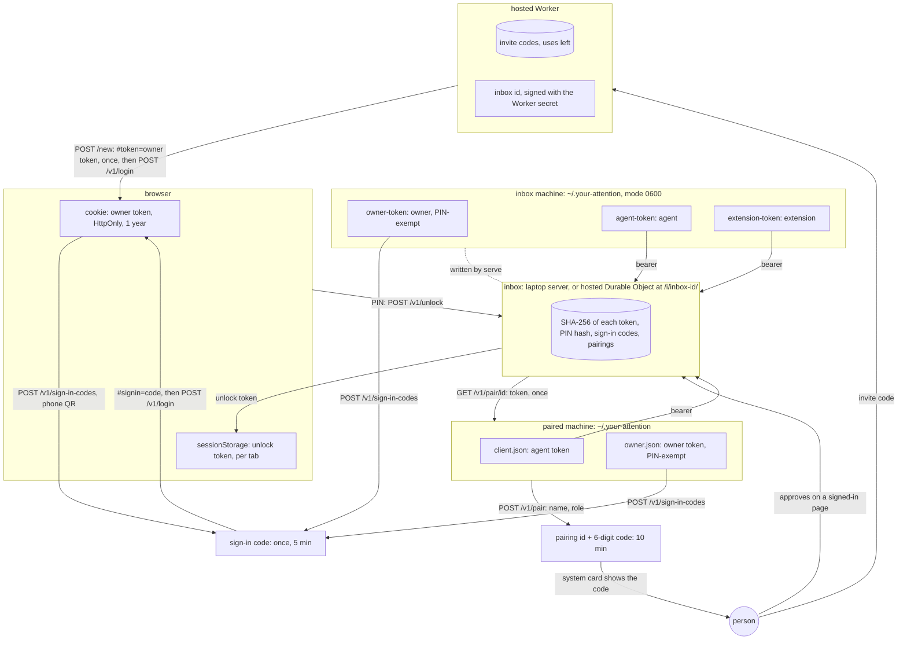

# Agent instructions

Your Attention is one inbox where coding agents ask a person questions as cards, and each answer goes back to the agent that asked. Read [PRINCIPLES.md](PRINCIPLES.md) and [SPEC.md](SPEC.md) before you change anything.

## Check every change against the principles

[PRINCIPLES.md](PRINCIPLES.md) is the authority on how the system must work. Check your change against it before you open a pull request. A change that breaks a principle is not ready to merge.

1. Before you write code, find the principles your change touches.
2. If the change would break a principle, stop. Either change the design, or amend the principle in the same pull request and say why in the body.
3. When a change adds or changes a message, a route or a card state, update SPEC.md in the same change.

Reviewers, human or automated, check the diff against PRINCIPLES.md and block a change that breaks one. `test/unit/principles.test.ts` checks the principles that a test can read off the source. Add a check there when you find another one.

## Layout

```
src/core/          the protocol: types, the single-writer inbox, the HTTP handler. Web standards only.
src/adapters/      SQLite storage and mDNS discovery for the laptop build, and the Mermaid check both builds use
src/node/          the Node HTTP server and the home directory
src/integrations/  Claude Code (MCP channel, AskUserQuestion hooks), pi, herdr
src/client.ts      the client every integration uses
src/cli.ts         the your-attention command
src/tui/           the terminal client: `your-attention tui`, on the page's web/answers.js and web/queue.js
web/               the built-in page: env.js, components.js, pin.js and app.js, plain JavaScript modules on the OpenUI browser bundle
web/stories/       Storybook stories for each component and for the whole page on a stand-in inbox
src/cloudflare/    the Worker and the Durable Object, with their storage adapters, and the usage collector
src/extensions/    the triage service
test/unit/         fast tests with in-memory storage
test/integration/  a real server, the CLI, the channel over MCP stdio, the pi extension, triage, links and mDNS
test/cloudflare/   the Durable Object with stand-ins, and the hosted build on wrangler dev
test/browser/      Playwright on the page, two people in two browser contexts, and every story
```

## Rules a reader cannot find in the code

- `src/core/` imports only other files in `src/core/`, so the same code runs on Node, Bun, Deno and Workers. Platform code goes in an adapter.
- Storage calls are synchronous. A method on `Inbox` finishes its change before the next change starts, which is how one inbox has one writer without locks. Never put an `await` between a read and the write that depends on it.
- Node runs the TypeScript sources directly, so write only syntax that Node can erase. Enums, namespaces and parameter properties fail at run time. Import local files with their `.ts` extension and types with `import type`.
- Logs from the Claude Code channel go to stderr, because stdout carries the MCP protocol.
- The herdr integration may send keys only to the pane of its own session. Never send keys to another pane.
- Each user-visible string names the thing it shows. The person may leave any answer field empty.

## Trust boundaries

Each box is a place that stores a secret, and each arrow is a secret crossing into it. A step that needs a box the person has no way into is friction. When a change touches sign-in, pairing or tokens, update this diagram in the same commit.



- The inbox stores a hash of each token, never the token. Only the machine or tab named in its box holds the secret.
- An owner token is the only key that signs in a new browser. A browser gets one from a sign-in code, or once from `POST /new`. The page removes `#token=` and `#signin=` from the address bar, so a bookmarked address signs nobody in.
- An agent token can't make a sign-in code, approve a pairing or read the state. On a machine paired only as an agent, the owner commands, `open`, `tui` and `pin`, say to pair as owner. That pairing goes in `owner.json` and leaves `client.json` to the agents.
- A token minted at `serve` or by pairing as owner skips the PIN. When the inbox has a PIN, a browser's owner token needs an unlock token as well, which the tab sends as `x-your-attention-unlock`. An unlock token ends after 12 hours without use.
- An invite code is the operator's secret. The hosted inbox keeps only its invite id, the first 16 hex digits of the code's SHA-256, for usage counts.

## Commands

```sh
npm ci
npm run typecheck        # tsgo and tsc-rs, and both must pass
npm test                 # unit, then integration
npm run test:cloudflare  # the Durable Object, and the hosted build on wrangler dev
npm run storybook:build && npm run test:browser   # Playwright, after building the stories
vale sync && vale *.md   # prose rules, the same ones CI runs
```

Set `YOUR_ATTENTION_SKIP_MDNS=1` to skip the mDNS test on a network that drops multicast.

## Pull requests

CI runs both type checkers, the tests on Linux, macOS and Windows, Vale on the Markdown files, dupdelta for new duplicate code, and gh-pr-body-action on the body. Cite reviews each pull request and reads this file.
