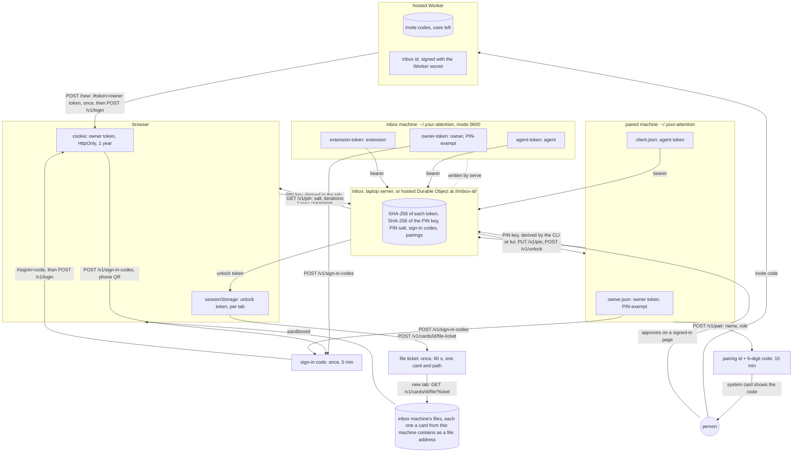

# Agent instructions

Your Attention is one inbox where coding agents ask a person questions as cards, and each answer goes back to the agent that asked. Read [PRINCIPLES.md](PRINCIPLES.md) and [SPEC.md](SPEC.md) before you change anything.

## Check every change against the principles

[PRINCIPLES.md](PRINCIPLES.md) is the authority on how the system must work. Check your change against it before you open a pull request. A change that breaks a principle is not ready to merge.

1. Before you write code, find the principles your change touches.
2. If the change would break a principle, stop. Either change the design, or amend the principle in the same pull request and say why in the body.
3. When a change adds or changes a message, a route or a card state, update SPEC.md in the same change.

Reviewers, human or automated, check the diff against PRINCIPLES.md and block a change that breaks one. `test/unit/principles.test.ts` checks the principles that a test can read off the source. Add a check there when you find another one.

## Layout

```
src/core/          the protocol: types, the single-writer inbox, the HTTP handler. Web standards only.
src/adapters/      SQLite storage and mDNS discovery for the laptop build, and the Mermaid and body checks of the laptop inbox and the posting client
src/node/          the Node HTTP server and the home directory
src/integrations/  Claude Code (MCP channel, AskUserQuestion hooks), pi, herdr
src/client.ts      the client every integration uses
src/cli.ts         the your-attention command
src/watch.ts       the line of JSON `your-attention watch` prints for each event of an agent stream
src/tui/           the terminal client: `your-attention tui`, on the page's web/answers.js and web/queue.js
web/               the built-in page: env.js, components.js, pin.js and app.js, plain JavaScript modules on the OpenUI browser bundle
web/stories/       Storybook stories for each component and for the whole page on a stand-in inbox
src/cloudflare/    the Worker and the Durable Object, with their storage adapters, and the usage collector
src/extensions/    the triage service
test/unit/         fast tests with in-memory storage
test/integration/  a real server, the CLI, the channel over MCP stdio, the pi extension, triage, links, the watcher and mDNS
test/cloudflare/   the Durable Object with stand-ins, and the hosted build on wrangler dev
test/browser/      Playwright on the page, two people in two browser contexts, and every story
```

## Rules a reader cannot find in the code

- `src/core/` imports only other files in `src/core/`, so the same code runs on Node, Bun, Deno and Workers. Platform code goes in an adapter.
- Storage calls are synchronous. A method on `Inbox` finishes its change before the next change starts, which is how one inbox has one writer without locks. Never put an `await` between a read and the write that depends on it.
- Node runs the TypeScript sources directly, so write only syntax that Node can erase. Enums, namespaces and parameter properties fail at run time. Import local files with their `.ts` extension and types with `import type`.
- Logs from the Claude Code channel go to stderr, because stdout carries the MCP protocol.
- The herdr integration may send keys only to the pane of its own session. Never send keys to another pane.
- Each user-visible string names the thing it shows. The person may leave any answer field empty.

## Trust boundaries

Each box is a place that stores a secret, and each arrow is a secret crossing into it. A step that needs a box the person has no way into is friction. When a change touches sign-in, pairing or tokens, update this diagram in the same commit.



- The inbox stores a hash of each token, never the token. Only the machine or tab named in its box holds the secret.
- An owner token is the only key that signs in a new browser. A browser gets one from a sign-in code, or once from `POST /new`. The page removes `#token=` and `#signin=` from the address bar, so a bookmarked address signs nobody in.
- Losing every owner credential closes the page. A cloud inbox's address does not sign a browser in, its sign-in link works once within five minutes, and an agent token cannot make a sign-in code, so recovery means a new inbox. The cards in the old one remain in a place nobody can open.
- An agent token can't make a sign-in code, approve a pairing or read the state. On a machine paired only as an agent, the owner commands, `open`, `tui` and `pin`, say to pair as owner. That pairing goes in `owner.json` and leaves `client.json` to the agents.
- The PIN never leaves the device that types it. The tab, the CLI and the terminal client derive a key from it with PBKDF2, using the salt from `GET /v1/pin`, and send the key. The inbox stores a SHA-256 hash of that key.
- A token minted at `serve` or by pairing as owner skips the PIN. When the inbox has a PIN, a browser's owner token needs an unlock token as well, which the tab sends as `x-your-attention-unlock`. An unlock token ends after 12 hours without use.
- The laptop inbox serves the owner a file on its computer only when a card from that computer contains the file's `file:` address. The agent that posted the card chooses what the route exposes. When the inbox has a PIN, the new tab opens the file only with a ticket that an unlocked tab asked for, which works once within 60 seconds. The file opens in a sandbox, so a served HTML page can't run scripts or read the cookie. The hosted inbox has no such route.
- An invite code is the operator's secret. The hosted inbox keeps only its invite id, the first 16 hex digits of the code's SHA-256, for usage counts.

## Commands

```sh
npm ci
npm run typecheck        # tsgo and tsc-rs, and both must pass
npm test                 # unit, then integration
npm run test:cloudflare  # the Durable Object, and the hosted build on wrangler dev
npm run storybook:build && npm run test:browser   # Playwright, after building the stories
vale sync && vale *.md   # prose rules, the same ones CI runs
```

Set `YOUR_ATTENTION_SKIP_MDNS=1` to skip the mDNS test on a network that drops multicast.

## Before you open a pull request

CI runs the same checks against the push, so a red run reports what the branch could have answered first. Merge `main` into the branch, then work through this list. The merge matters as much as the checks: it is where a conflict, or a name that both sides introduced, appears.

1. `npm ci` when the lock file moved, so the tree these checks read is the tree CI installs.
2. `npm run typecheck` runs tsgo and tsc-rs over the Node and Worker projects. CI runs them as two jobs, `typecheck (tsgo)` and `typecheck (tsc-rs)`, and one can fail while the other passes.
3. `npm test` is `test:unit` then `test:integration`. CI runs both on Ubuntu, macOS and Windows, so a Windows run has caught a file lock that Linux never showed. Say in the body when the suite ran on one system only.
4. `npm run cloudflare:check` and `npm run test:cloudflare`. The second builds the Worker. The first is the dry-run deploy that CI runs in the same job.
5. `npm run storybook:build && npm run test:browser`. The browser job builds the stories before Playwright starts, and a story that does not build fails the job on its own.
6. `vale sync && vale *.md` runs the prose rules over this file and its link, CLAUDE.md. The prose job reports errors only, so a warning here is advice. Run `vale sync` in a fresh worktree, or every file fails with `style 'ai-tells' does not exist`.
7. The body is the strict one. `vale --no-global --config .vale.ini <body>.md` must report neither errors nor warnings, because the pr-body job runs gh-pr-body-action with `prose-fail: 'true'` at `MinAlertLevel = warning`. A body that reads well still fails on a section whose sentences open the same way, on a passive "was created", or on the word "unlock".

dupdelta reads the diff against the merge base and reports new duplicate runs, as warnings. It has no local command, so read its annotations after the push: a run of about a hundred tokens is a helper that belongs in one place. Every `test/browser` spec opens with the same lines, and dupdelta reports those as well.

When a check fails and the cause is not yours, say so in the body. The mDNS test needs multicast, which GitHub's macOS runners drop, so that job sets `YOUR_ATTENTION_SKIP_MDNS`. A Windows job occasionally reports `EBUSY` on an inbox file right after a server stops, and a rerun passes.

## Pull requests

Open the pull request as a draft, and mark it ready once the checks above are green. Cite reviews each pull request and reads this file, so a change that breaks a principle in PRINCIPLES.md is a request to amend the principle in the same pull request.
