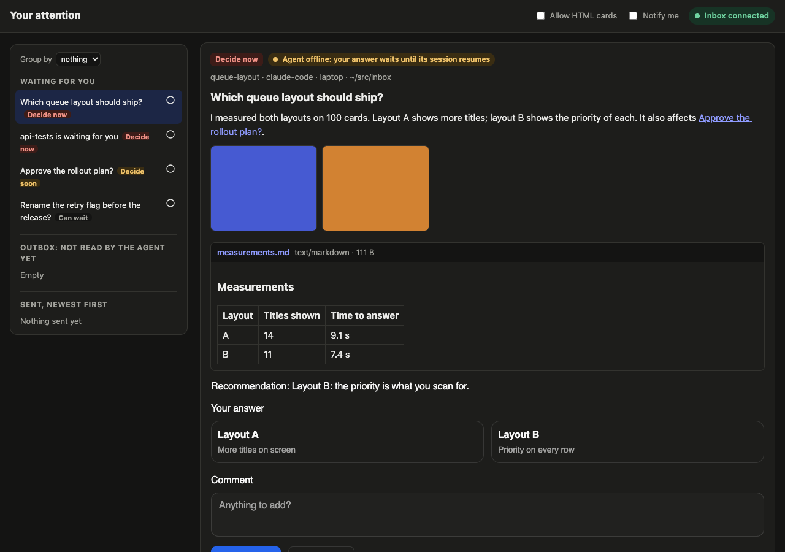

# Your Attention

One inbox for the questions all your coding agents ask you. An agent posts a card and keeps working. You answer in one place, and the answer goes back to that session within a second.



## Why it helps

With 100 sessions open, a question waits in whichever terminal asked it, and you find it late or never. Your Attention puts every question on one queue, sorted by priority, one card at a time. Each card shows whether its agent is listening, busy or offline, and where your answer is: stored, delivered, or read by the model. An answer to an offline agent waits until its session resumes.

Claude Code and pi post cards through tools, and herdr turns any blocked agent into a card. A secret card requests a key: your browser encrypts it for that session, and the model sees the path of a private file instead of the value. Each new client pairs with a code you confirm.

[PRINCIPLES.md](PRINCIPLES.md) states the design and [SPEC.md](SPEC.md) the protocol.

## Set it up

These steps take a machine with only a coding harness on it to a full setup. A coding agent can run them for you. Steps marked (optional) add a feature, and you can skip them.

1. [Check what you need](#1-check-what-you-need).
2. [Choose a home for the inbox](#2-choose-a-home-for-the-inbox).
3. [Install the command](#3-install-the-command).
4. [Start or open your inbox](#4-start-or-open-your-inbox).
5. [Connect your agents](#5-connect-your-agents).
6. [Open the inbox on your phone (optional)](#6-open-the-inbox-on-your-phone-optional).

### 1. Check what you need

- **Node 22.18 or later.** The `your-attention` command runs on it. Check with `node --version`.
- **git**, to get the code.
- **A coding harness**, such as Claude Code, pi, or any agent that herdr runs. Your agents post cards from it.
- **A browser.** The inbox is a web page.

### 2. Choose a home for the inbox

The inbox is one server that holds your cards. Pick one place for it:

| Where | What you get | Choose it when |
| -- | -- | -- |
| On your laptop | Unlimited and free, without an account. Agents on the same machine find it on their own. It stops when the laptop sleeps. | You work from one machine. This is the default. |
| Your own Cloudflare inbox | Always on, reachable from any machine and your phone. You deploy it to your own Cloudflare account. | You run agents on several machines, and want to own the deployment. See [Run your own cloud inbox](#run-your-own-cloud-inbox-optional). |
| A hosted inbox | Always on, with no deployment. Someone who runs the service gives you an invite code. Each inbox has [limits](#limits-of-a-cloud-inbox). | Someone already runs the service for you. |

You can change your mind later. Each machine pairs with one inbox at a time.

### 3. Install the command

Agents talk to the inbox through the `your-attention` command, so you install it wherever an agent runs.

```sh
git clone https://github.com/elecnix/your-attention ~/Source/your-attention
cd ~/Source/your-attention && npm ci && npm link
your-attention --help
```

`npm link` puts `your-attention` on your path. To update later, run `git pull && npm ci` in the same folder.

### 4. Start or open your inbox

**On your laptop:**

```sh
your-attention start            # runs the inbox in the background, on port 4815
your-attention open             # opens the inbox page, signed in
your-attention open --link      # prints a one-time sign-in link, for a private window or another browser
```

The inbox keeps its files in `~/.your-attention`. Set `YOUR_ATTENTION_HOME` to move them.

To start the inbox when you log in (optional), write a launchd or systemd unit. Without `--write`, the command only prints the unit.

```sh
your-attention service serve --write
```

**On a hosted inbox:**

1. Open the address you got with your invite code. Enter the code, then select **Create my inbox**.
2. The page opens your inbox, signed in. Bookmark that address, and keep it private.
3. Pair each machine that runs agents, as [step 5](#pair-a-machine-with-a-cloud-inbox-or-another-computer) shows.

**On your own Cloudflare inbox:** deploy it first, as [Run your own cloud inbox](#run-your-own-cloud-inbox-optional) shows. Then pair each machine, as step 5 shows.

### 5. Connect your agents

Do the parts for the harnesses you use.

#### Claude Code

Add the channel server once. It gives every session the card tools, and brings your answers into the session as they arrive.

```sh
claude mcp add -s user your-attention -- your-attention claude-channel
```

Claude Code loads a channel only from a launch flag. Start each session with it, and confirm the development-channel warning that Claude Code shows:

```sh
claude --dangerously-load-development-channels=server:your-attention
```

Keep the `=` form: the flag takes a list, and would read a prompt after it as a second server.

**A shell function that adds the flag (optional).** It adds the flag to interactive starts, and leaves subcommands and `--print` alone. Put it in `~/.bashrc` or `~/.zshrc`:

```sh
claude() {
  case "${1:-}" in
    -p|--print|mcp|config|doctor|update|install|plugin|setup-token|migrate-installer|--version|-v|--help|-h) command claude "$@" ;;
    *) command claude --dangerously-load-development-channels=server:your-attention "$@" ;;
  esac
}
```

**Questions from `AskUserQuestion` as cards (optional).** Add these hooks to `~/.claude/settings.json`, next to any hooks you already have. Answer in either place. Your terminal answer closes the card, and a card answer goes to the session. In herdr, the terminal dialog closes too. When you cancel the dialog, or the session moves on without an answer, `ask-cancel` closes the card.

```json
{ "hooks": {
  "PreToolUse":         [{ "matcher": "AskUserQuestion", "hooks": [{ "type": "command", "command": "your-attention claude-hook ask-pre", "timeout": 10 }] }],
  "PostToolUse":        [{ "matcher": "AskUserQuestion", "hooks": [{ "type": "command", "command": "your-attention claude-hook ask-post", "timeout": 10 }] }],
  "PostToolUseFailure": [{ "matcher": "AskUserQuestion", "hooks": [{ "type": "command", "command": "your-attention claude-hook ask-cancel", "timeout": 10 }] }],
  "PermissionDenied":   [{ "matcher": "AskUserQuestion", "hooks": [{ "type": "command", "command": "your-attention claude-hook ask-cancel", "timeout": 10 }] }],
  "UserPromptSubmit":   [{ "hooks": [{ "type": "command", "command": "your-attention claude-hook ask-cancel", "timeout": 10 }] }],
  "SessionEnd":         [{ "hooks": [{ "type": "command", "command": "your-attention claude-hook ask-cancel", "timeout": 10 }] }]
} }
```

#### pi

```sh
pi install git:github.com/elecnix/your-attention
```

#### herdr: a card for each blocked agent (optional)

The sidecar posts a card when any herdr agent waits for you, whatever its harness. When the agent shows numbered choices, such as a permission prompt, you pick one on the card, and the sidecar presses it in that agent's pane. It first checks that the same prompt still waits there.

```sh
your-attention herdr-blocked &
```

#### Pair a machine with a cloud inbox or another computer

A machine whose inbox runs elsewhere pairs once:

1. Run `your-attention pair <inbox address>` on that machine. It prints a six-digit code.
2. A card with a code appears in your inbox. Approve it only when the code matches.
3. The machine saves its token in `~/.your-attention/client.json`, and its agents use that inbox from then on.

For a hosted inbox, the address is the one you bookmarked, such as `https://app.example.workers.dev/i/<inbox id>`. On your network, `your-attention discover` lists the laptop inboxes it finds, with their addresses.

```sh
your-attention discover
your-attention pair http://<host>:4815
```

To pair a front-end that answers cards instead of an agent, add `--role owner`.

#### Check your cards before you see them (optional)

Triage reads each new card and sends back one that lacks a goal, options, evidence or a recommendation. It uses your own OpenRouter account, or runs a coding harness in print mode:

```sh
your-attention triage login                         # once, for OpenRouter
your-attention service triage --write               # a launchd or systemd unit
your-attention triage --judge-cmd "claude -p"       # or a harness instead
```

#### Reach a laptop inbox from containers, CI or other machines (optional)

Agents that can't reach your laptop connect through a bridge, an SSH tunnel or a relay:

```sh
your-attention bridge --upstream https://inbox.example
your-attention offer ssh build-box
YOUR_ATTENTION_RELAY_KEY=... your-attention serve --relay https://relay.example
```

### 6. Open the inbox on your phone (optional)

Select the phone button, left of the GitHub mark, and scan the QR code with the phone camera. The phone opens the inbox, signed in with its own token. The code works once, for five minutes, so keep it to yourself.

A cloud inbox works from anywhere, and a laptop inbox from a phone on the same network. The laptop inbox listens on every network interface, IPv4 and IPv6, by default. Its QR code opens the laptop's `.local` name, such as `http://my-laptop.local:4815`, and the dialog also gives an IP address, for a phone that cannot open `.local` names.

If the phone cannot open the inbox, check for a VPN on the laptop. A VPN that sends your home network's IPv4 traffic into its tunnel breaks every connection from the phone to the laptop over IPv4. The inbox still answers over IPv6, which most home networks and phones use. Otherwise, exclude your home network from the VPN, or use a cloud inbox.

## Day to day

Answer cards on the inbox page. Each answer reaches its agent within a second, or when its session resumes.

```sh
your-attention clear            # clears the cards you answered or that closed; search still finds them
your-attention reset --yes      # removes every card, answer and file; tokens and templates stay
your-attention login-url        # prints the page address with its sign-in token
your-attention stop             # stops the inbox, or its launchd or systemd service
```

`clear`, `reset`, `login-url` and `stop` act on the inbox this machine runs.

## Run your own cloud inbox (optional)

The Cloudflare build runs the same inbox on Workers. Each inbox is one Durable Object that sleeps when idle. Choose a mode when you deploy:

- **single** serves one inbox, yours, at the root address.
- **hosted** serves many inboxes. Each person creates one with an invite code you give out.

You need a Cloudflare account with R2 turned on once in the dashboard, a workers.dev subdomain, Terraform, and the GitHub CLI.

1. Create the KV namespace, the R2 bucket, its 30-day expiry rule, and a deploy token that can change Workers only. The state file contains that token, so it stays outside the repo:

   ```sh
   export CLOUDFLARE_API_TOKEN=...                  # an account token that can create tokens, KV and R2
   terraform -chdir=cloudflare init -backend-config="path=$HOME/.your-attention/cloudflare.tfstate"
   terraform -chdir=cloudflare apply -var account_id=<account id>
   ```

2. Put the outputs in the repo's `cloudflare` environment:

   ```sh
   terraform -chdir=cloudflare output -raw deploy_token | gh secret set CLOUDFLARE_API_TOKEN --env cloudflare
   gh variable set KV_NAMESPACE_ID --env cloudflare --body "$(terraform -chdir=cloudflare output -raw kv_namespace_id)"
   gh secret set CLOUDFLARE_ACCOUNT_ID --env cloudflare --body "<account id>"
   ```

3. Add the secret for your mode:

   - Single mode needs `OWNER_TOKEN`, your owner token. It is 12 hex digits, a dot, and 64 hex digits: `echo "$(openssl rand -hex 6).$(openssl rand -hex 32)" | gh secret set OWNER_TOKEN --env cloudflare`. Keep a copy: you sign in with it.
   - Hosted mode needs `INBOX_ID_SECRET`, which signs inbox addresses: `openssl rand -hex 32 | gh secret set INBOX_ID_SECRET --env cloudflare`. Changing it later makes every inbox address invalid.

4. Run the `deploy-cloudflare` workflow from the Actions tab, and pick the mode. The Worker is named `app`, so it answers at `https://app.<subdomain>.workers.dev`.

5. In single mode, open `https://app.<subdomain>.workers.dev/#token=<owner token>`. In hosted mode, add an invite code. Codes need 20 characters or more, and the last number is how many inboxes the code creates:

   ```sh
   npx wrangler kv key put invite:$(openssl rand -hex 16) 5 --binding INVITES --remote
   ```

   That command doesn't print the code. Put it in a variable first if you want to give it out.

### Limits of a cloud inbox

The Cloudflare build sets these in `wrangler.jsonc`, so a free account stays within its quotas:

- 100 MB of uploaded files over the inbox's life. Each file counts as at least 64 KB, and the count doesn't go down when a file is deleted.
- 20 MB in the inbox's database. A full inbox takes only deletes, answers and closes until you make room.
- 2,000 file downloads a day for each client.
- 300 requests a minute for each signed-in client address, per inbox, and 100 a minute for each address without a token.
- R2 deletes each file 30 days after its upload. The card stays.
- Pages and agents get their events over WebSockets, so an idle inbox sleeps. The event stream and long-poll routes answer 410.

A laptop inbox has none of these limits.
