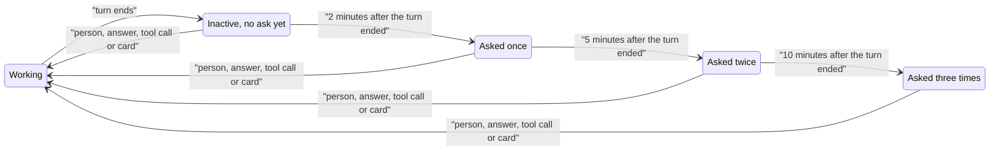

# Protocol specification, version 1

This file specifies the messages, card states and delivery rules that every inbox and client follows. The TypeScript types in `src/core/types.ts` mirror it, and the integration tests in `test/integration/` are the conformance suite. A build in another language passes the suite when it serves the same routes.

## Transport and encoding

Messages are JSON over HTTP. Agents receive events in whichever of three ways their environment allows:

- `GET /v1/stream?agent=<id>`: server-sent events, the default. Pages use `GET /v1/events` the same way.
- `GET /v1/ws` without an upgrade: `{webSocket: true}`, the answer a page uses to tell a build that serves a page socket from one that does not.
- `GET /v1/ws?agent=<id>`: a WebSocket. A client that cannot send an Authorization header sends `{type: "auth", token}` as its first frame, and acknowledges with `{type: "ack", card}`. A session whose origin changed reports it with `{type: "origin", origin}`. The client sends `{"type":"ping"}` every 20 seconds and gets `{"type":"pong"}`. An inbox closes a socket that sends nothing for 60 seconds, and the laptop build also sends WebSocket ping frames every 15 seconds. The Cloudflare build counts pings only: it closes a socket 5 minutes after its last ping, whatever other frames it sends.
- `GET /v1/poll?agent=<id>&wait=25`: a long-poll that returns `{events}` at the first answer or after `wait` seconds. The inbox ends the wait at once when the client drops the connection.

The Cloudflare build serves events over the WebSocket only, so `GET /v1/stream`, `GET /v1/events` and `GET /v1/poll` answer 410. The Worker returns that status itself, so the inbox object never wakes, and logs an agent that retries once a minute.

Each stream sends a `beat` event every 2 seconds, so a client can tell a quiet inbox from a dead one. The inbox reports an agent offline 2 seconds after its last connection closes, so a reconnect or the next poll does not flicker its presence. The inbox keeps an agent's presence row for 30 days after the agent goes offline, and the sweep then deletes it, so `GET /v1/state` does not grow with every session that ever connected. The sweep never deletes the row of an online agent. An agent that reconnects after the prune gets a fresh row, and any answer that waited for it.

`GET /v1/info` returns `{"name":"your-attention","version":"0.1.1","protocol":1,"id":"<inbox id>","pair":"/v1/pair","checks":{"diagrams":true,"body":true}}`. `version` names the release an inbox runs, which tells one deployment from another, and the page shows it when the person hovers over the GitHub mark. The id stays the same over every link to the inbox. `checks` says what the inbox checks itself before it takes a card, as [Checks on the client](#checks-on-the-client) describes. An inbox whose answer has no `checks` checks both.

## One message over several links

A client may use several links to one inbox, such as a direct link and a relay. It checks that each link reports the same `id` as the first link, or as the id that pairing saved, and skips any other.

A write may include an `x-message-id` header of 8 to 64 characters from `[A-Za-z0-9_-]`. The inbox applies the first request with that id from that client, and answers every later one with the stored result and `x-message-id-replayed: 1`. It forgets an id after 24 hours. The client in `src/client.ts` sends one id per write and keeps it across retries, and it counts an answer once when two links deliver it.

## Links

- `your-attention bridge --upstream <url>` runs a proxy on another machine. It forwards each caller's own token and grants nothing by itself. With `--mdns`, the bridge advertises the upstream inbox id.
- `your-attention offer ssh <host>` opens a reverse SSH tunnel, so agents on that host connect to `http://127.0.0.1:4815`.
- `your-attention relay` runs a relay on a public machine. `your-attention serve --relay <url>` dials out to it over a WebSocket, so the inbox is at `<relay>/i/<inbox id>/` with no open port. The relay key in `YOUR_ATTENTION_RELAY_KEY` only registers inboxes. Every request through the relay still needs the inbox's own token.

## Hooks and extensions

An extension dials in like an agent: `GET /v1/extensions/stream?name=<name>&hooks=<a,b>&timeoutMs=<ms>&policy=fail-open|fail-closed`, with an `extension` or `owner` token. Hook calls use their own messages, version 1, separate from the agent messages:

| Hook | When | What an extension may do |
| -- | -- | -- |
| `card.created` | Before the person sees a new or revised agent card. The call includes the card and the presence of the person. | Answer `POST /v1/hooks/<call id> {verdict, reason, advice}` with `pass`, `hold` or `return`. |
| `answer.saved` | After the person saves an answer. | Observe only. |
| `person.changed` | When a page opens, closes, hides or shows another card. | Observe only. |

While an extension checks a card, the card is `in-triage` and the person does not see it. Every extension on the hook must pass the card. `return` closes the card as `returned` and sends the agent a `returned` event with the reason, and the agent can answer it with [feedback](#feedback-on-triage-pushback). A `pass` with `advice` opens the card for the person and sends its agent an `advice` event, `{type: "advice", id, card, advice, by}`, where `by` is the extension's name. The agent can then write its next card better without a second round of triage. The card keeps the advice in its [pushback](#feedback-on-triage-pushback) list, so the agent can give feedback on it too. When several extensions check a card, the advice waits until the last one passes it, and a hold or a return by any of them drops it. The inbox keeps 4000 characters of a reason and of advice, and ignores advice on a hold or a return. A `pass` may also send `{"bypass": true}`, for an extension whose checks did not run because the agent used a bypass code. The inbox keeps it as `triage.bypass`, and the card's header shows it as a red badge, against green for a card triage checked and grey for one it did not. A card opened by its address while an extension still checks it shows that grey dot pulsing slowly, and a system set to reduce motion shows the same dot still, with a faint centre mark so it still differs from a card nobody checked. `hold` keeps the card `held` until the owner releases it with `POST /v1/cards/<id>/release`. A dialog card is the exception: an `ask-pre` hook that sees the hold inside its wait closes it as `resolved`, because its dialog will not open. The `dialog` field in [Cards](#cards) describes that close.

A hook call without a verdict by its deadline follows the policy: `fail-open` passes the card, and `fail-closed` holds it. The card shows the extension and the reason, and the reason says how long the inbox waited, from the extension's timeout, such as `triage-example did not answer within 5 min 10 s, so the card went through.` With no extension on `card.created`, cards go straight to the person, and an extension that connects later screens the cards that arrived while it was away, never the older ones. The platform alarm resolves deadlines, so the inbox itself doesn't set timers.

`POST /v1/webhooks {hook, url}` sends observe-only hook calls to an https service. Each call has the header `x-your-attention-signature: sha256=<HMAC-SHA256 of the body>`, keyed with the secret that the create call returns once. [Answer webhooks](#answer-webhooks) sends the answers to an agent's own cards to a webhook of its choice.

## The triage extension

`your-attention triage` checks that each card states a goal, the options that the agent weighed, evidence, and a recommendation. The prompt includes the card's kind, dialog flag, title, text, recommendation, option labels, questions, secret field names, HTML, body, attachment names and tags, so a guidance rule can check any of them. A dialog card, a question the harness also opens in the terminal, passes on a question that says what the agent needs and distinct options. Neither a separate evidence paragraph nor a recommendation belongs in it, since the dialog has no field for either. It also searches earlier answers, and returns a card that an earlier answer covers. It returns a card whose text asks two or more questions above one `options` list, so the agent posts them as `questions`. By default it uses OpenRouter, with the key from `your-attention triage login`, an OAuth PKCE sign-in. `--judge-cmd "claude -p"` uses a coding harness in print mode instead, and `--judge-url` uses any OpenAI-compatible endpoint. A judge that fails or answers in an unreadable form passes the card. `your-attention service triage` writes a launchd or systemd unit for it.

[examples/triage-agent](examples/triage-agent/README.md) is a triage extension to copy and change: vale checks each card's prose, pr-context-classifier checks the card against a card prompt, and a Links check reads every field the person sees with the page's own Markdown renderer, so a pull-request reference or an address the page would draw as dead text goes back with the rest of the findings. The example reuses `runCardHook` from `src/extensions/card-hook.ts`, the loop that `your-attention triage` runs too, and runs beside the built-in triage or instead of it.

## Feedback on triage pushback

The person tunes the triage gate from what agents say about it. Each time an extension returns a card, the inbox appends `{kind: "returned", by, reason, version, at}` to the card's `pushback` list. Once every extension has passed a card, the inbox appends `{kind: "advice", by, reason, version, at}` the same way for each extension that gave advice, with the advice as the reason. A card that goes back or is held doesn't get an advice entry. `by` is the extension's name and `version` the card version it checked. A revision keeps the list, so the page shows each reason next to the feedback that answers it, even after the card passes. The list keeps the 10 newest entries. It has its own size cap, like the history, so the 256 KB card limit leaves it out and full feedback never blocks a revision. The inbox adds nothing when the inbox page sends a card back, since no triage extension judged it.

The `returned` event of a triage return has an `extension` field with the extension's name. Its notice ends with one sentence that points the agent to `card_triage_feedback`, so the person can tune the gate. The notice of an `advice` event ends with the same kind of sentence. The notice of a card the page sent back has no such sentence.

An agent sends its feedback with `POST /v1/cards/<id>/triage-feedback`:

```json
{
  "verdict": "partly",
  "comment": "The goal was in the title.",
  "findings": [{ "index": 1, "verdict": "disagree", "comment": "The title says it." }, { "quote": "Option B has no description", "verdict": "agree" }]
}
```

`verdict` is `agree`, `disagree` or `partly`, and every other field is optional. A finding points at a part of the reason by `index`, counting from 1, or by a `quote` from it, and has its own verdict and comment. The inbox adds the feedback, the agent id and the time to the latest pushback, and returns the card. A second call on the same pushback replaces the first, so each pushback keeps one verdict: the agent may change its mind after it revises the card, and a count of verdicts counts each pushback once. Only the token that posted the card may send feedback, so the owner and other agents get 403. A card without a pushback answers 409. The comment takes at most 2,000 characters, a finding's comment 1,000 and its quote 300, and a call at most 20 findings. Past a limit the inbox answers 400, so the record keeps every word the agent wrote. `card_triage_feedback` sends it from a harness.

The page shows a collapsed **Triage pushback** section on the card, next to **What changed**. It opens to each pushback with its version, extension, time and reason, and under each one the agent's verdict, comment and findings, with a line at their left in the ok color for agree, the warn color for partly, or the bad color for disagree.

`GET /v1/search` and `GET /v1/cards` take `triage_feedback=any` to keep the cards with feedback, or `agree`, `disagree` or `partly` to keep one verdict. `card_search` takes the same filter as `triage_feedback`, and each result lists the card's pushback with its verdict.

For mining, `GET /v1/triage-feedback` exports the data to the owner, which takes the same `triage_feedback` filter. It answers `{records}`, one record per card triage pushed back on, oldest first: `{card, title, agent, state, outcome, pushback, followedBy?}`, where each pushback entry has `feedback` set to null when the agent gave none. `outcome` says how the card ended: `answered`, `passed` when triage let a later version through to the person, `returned` while it stays sent back, or the kind it closed with, such as `expired` or `retracted`. Other tokens get 403. `your-attention triage feedback [--verdict any|agree|disagree|partly]` prints each record as one line of JSON.

## Person presence

Each page opens a WebSocket at `/v1/ws?page=1&viewer=<page id>&unlock=<unlock token>`, signed in with its cookie. A browser doesn't report a status for an upgrade that fails, so the page asks `GET /v1/ws` without an upgrade after one. An answer of 410, 404 or 426 tells it this build has no page socket, and it reads `GET /v1/events?viewer=<page id>` instead. A 423 tells it the inbox needs its PIN. Any other answer leaves it retrying the socket with backoff. A stream that fails or ends sends the page back to the socket, so the stream is never where it stays. Its status pill reads `Inbox connected`, `Inbox reconnecting` while `GET /v1/state` still answers, and `Inbox unreachable` only when that stops too. The page socket sends the same events as the stream. The page sends `{"type":"ping"}` every 2 seconds and gets `{"type":"pong"}`. Each page reports `POST /v1/person/<page id> {visible, active, focus}`. The inbox combines the pages into `{pages, visible, activeAt, focus}` at `GET /v1/person`, for the owner and extensions. With two people on one inbox, each page counts.

## Clients and tokens

Each client sends `Authorization: Bearer <token>`. A token has one of three roles:

- `owner` reads every card and answers them. The built-in page and other front-ends use it.
- `agent` posts cards and receives the answers to them. It can also search past answers.
- `extension` reads every card and the presence of the person, and answers hook calls. Triage uses it.

The inbox stores a SHA-256 hash of each token, never the token. The page signs in with `POST /v1/login {token}`, which sets an `HttpOnly`, `SameSite=Strict` cookie. A write that uses the cookie must also send the `x-your-attention: 1` header, which a cross-site form can't set.

On a laptop, the server writes `owner-token` and `agent-token` to its home directory with mode 0600, so processes of the same user connect without pairing.

## Pairing

1. The client sends `POST /v1/pair {name, role}` and gets `{id, code}`, where the code has six digits.
2. The inbox posts a system card that shows the name, the role and the code.
3. The person checks that both screens show the same code, then picks `approve` or `deny` in the `choice` field.
4. The client polls `GET /v1/pair/<id>`. It gets `{status:"approved", token}` once, then `{status:"approved"}` after that.

At most 5 requests can wait at a time, and a request that waits 10 minutes expires as denied.

## The PIN

Whoever holds the inbox address or a sign-in link could answer as the person, and each answer goes straight into an agent's session. With a PIN of 4 digits set, that credential opens nothing until the browser tab types the PIN.

The inbox refuses a request with 423 `{error, locked: true}` when the request signs in with the cookie, or with an owner token that someone can copy as a link, and doesn't send a live unlock token. Such owner tokens come from sign-in codes, from `POST /new` on the hosted service, and from the single-mode `OWNER_TOKEN`. A locked caller may call the PIN routes below. It may also read `GET /v1/attachments/<id>`, since an image tag can't send a header and the attachment ids show up only in what an unlocked page reads. Owner tokens with `pinExempt` skip the PIN as bearer tokens. The laptop's `owner-token` file has it, and so does each token paired with `role: owner`, which the person approved on the page. Agent and extension tokens never need the PIN.

| Route | Who | Does |
| -- | -- | -- |
| `GET /v1/pin` | owner | `{set, salt, iterations, newIterations, neverAsk, unlocked, lockedUntil, triesLeft, exempt}` |
| `POST /v1/unlock {key}` | owner | `{unlock, idleMs}`, or 401 `{triesLeft}`, or 429 `{lockedUntil}` with `retry-after` |
| `PUT /v1/pin {key, salt, iterations, current}` | owner | Sets the PIN. A gated caller sends `current` when a PIN exists, and gets a fresh `unlock`. |
| `DELETE /v1/pin {current}` | owner | Removes the PIN, with the same rule for `current`. |
| `PUT /v1/pin/never-ask {neverAsk}` | owner | Stores whether the page and the CLI offer to set a PIN. |
| `POST /v1/lock` | owner | Ends the unlock token in the request's header. |

The page sends its unlock token in the `x-your-attention-unlock` header. The page socket and the event stream can't send headers, so they put it in `unlock=`. The page keeps the token in `sessionStorage` under `ya-unlock:<page path>`, never in `localStorage` or a cookie, so closing the tab ends it. Each unlock token belongs to the owner token that unlocked, and the inbox stores its SHA-256 hash in `meta`. The inbox ends a token after 12 hours without a request, at `POST /v1/lock`, when someone revokes its owner token, and when the PIN changes or goes. Then the inbox closes each page socket and event stream that opened with it, with code 4423 on a socket. The message memory never keeps a PIN route's response.

The PIN never leaves the client. The page, the landing page and the CLI derive a key from it with PBKDF2-SHA256, 32 bytes sent as 64 lowercase hex digits. They send the key in `key` and `current`, never the PIN:

- To unlock, or to prove the current PIN, the client derives with the `salt` and `iterations` that `GET /v1/pin` returns for the PIN that is set.
- For a new PIN, the client draws a random 16-byte salt and derives with the `newIterations` that `GET /v1/pin` returns. It sends the key with the salt and the count, and the inbox answers 400 for any other count.

Both builds hand out 800,000 iterations, about 100 ms on a laptop, so the hosted inbox doesn't run a slow hash in its 10 ms of CPU time. `web/pin-key.js` derives the key on the page, and `src/core/pin.ts` derives the same key in Node. A browser gives Web Crypto to secure origins only, so a phone that opens a laptop inbox at a plain-HTTP address derives the key in plain JavaScript. That takes about 2 seconds on a laptop and 7 seconds on a CPU four times slower, so the page shows how far it got. The inbox keeps the PIN in `meta` under `pin` as `{key, salt, iterations, setAt, neverAsk}`, where `key` is the SHA-256 of the derived key. A laptop PIN set before clients derived keys is stored as `{hash, salt, iterations}`, where `hash` is the derived key itself, and it keeps working: the inbox compares against the SHA-256 of `hash`. The comparison takes the same time wherever the bytes differ. The inbox never logs or returns a PIN or a key.

Each wrong key counts in `meta` under `pin-tries` before the hash runs, so tries sent at once all count. The fifth wrong try starts a lockout of 1 minute. Each later lockout lasts twice as long as the one before, up to 24 hours, and even the right PIN waits it out. The right PIN, a new PIN, and removing the PIN reset the count, and a restart keeps it. With an exempt token, `your-attention pin reset` sets or removes a forgotten PIN without `current`, during a lockout too.

The page offers to set a PIN each time it opens, as long as the inbox has none and `neverAsk` is false. It shows **Skip** and **Never ask again**. In a terminal, `serve` and `start` ask the same, with the PIN typed hidden and twice. A run without a terminal never asks. `your-attention pin status|set|reset|clear` reads and changes the PIN with the `owner-token` file, or with the token of a machine paired as owner. `set` refuses to replace a PIN, and `reset` replaces it without the old one.

## Cards

An agent posts `POST /v1/cards` with these fields. Only `agent` and `title` are required.

| Field | Meaning |
| -- | -- |
| `id` | 1 to 80 characters: letters, digits, dots, colons, dashes or the `_` character. Posting the same id again revises the card and adds 1 to its `version`. |
| `agent` | The session that receives the answer, such as `claude:<session id>`, `pi:<session id>` or `opencode:<session id>`. |
| `kind` | `ask` (the default), `blocked` for a harness that waits on a prompt, or `system`. The inbox posts its own `system` cards, such as a pairing request. A client posts a `system` card only to ask the inbox for something, with the request in `system`, as [Answer webhooks](#answer-webhooks) describes. The inbox answers 400 to a client's `system` card without a request, and to a `secret` card, which the [secret widget](#secret-widget) replaced. |
| `title`, `text`, `recommendation` | The question, its context, and what the agent would do. `title` is one line of plain text. The page, the terminal client, a notification and a search result show it as it is written, so Markdown in a title reads as its own source. A link belongs in `text`, or in a field label of the body. |
| `options`, `multiple` | Answer options as `{id, label, description, recommended}`. The page shows each option as a box the person clicks, with its description inside, as inline Markdown. The person picks with the `choice` field, and the answer gives the picked option's id, or its label when the option has none. An agent marks its recommended option with `recommended: true`. The page offers one pick on a card without `multiple`, and every pick on a `multiple` card. A card without `multiple` takes one recommended option at most, and the inbox answers 400 to a second one. The `card_post` tool takes each option as `{label, description, recommended}` or as a plain label. An option may leave out its id. A client that posts through the `card_post` tool gives each option `o` and its position first, so such a card has `o1`, `o2` and so on. For a post or a patch that gives an option no id, the inbox derives one from the label. It lowercases the label and turns each run of characters that are not letters or digits into one dash, joining those runs. The id keeps the first 60 characters of that result, and a cut there can leave a dash at the end. A run at either end of the label doesn't give a dash, so `!Go-ahead!` gives `go-ahead`. A label with no letters or digits gives `option-` and the option's position, counting from 1, as an empty label does. When the card already has that id, the inbox adds a dash and the smallest number from 2 that the card doesn't have, so two `Go ahead` labels give `go-ahead` and `go-ahead-2`, and a later label `Go ahead 2` gives `go-ahead-2-2`. An id the agent gave stays as it is, so two options it marks with one id keep that id, and every id the inbox derives is unique within the card. For a card that has an answer or a draft, the inbox derives nothing new. An option that still has the label of a stored option keeps that option's id. |
| `questions` | The questions of a card that asks two or more, each `{question, header, text, options, multiSelect}`, with each option as `{label, description, recommended}`. The page and the terminal client draw the card's `text` first, then each question as its own section. A section opens with the question as a heading and its `text` in Markdown, and ends with the option boxes and a comment field. A question without `options` takes a free-text answer instead. The answer gives the first question's pick in `q0`, by the option's label, and its comment in `q0_comment`. The agent reads one line per question, the question and the answer, with an indented `Comment:` line under it. The inbox answers 400 for a question with an empty `question`, for two options with one label, and for two recommended options on a question without `multiSelect`. The Claude Code `AskUserQuestion` hook posts its questions in this field too. It titles the card with the questions' `header` labels joined by ` · `, so each question's text appears once, in its section. |
| `dialog` | `true` when the questions are also open as a dialog in the agent's terminal, as the `AskUserQuestion` hook posts them. Triage applies the dialog rule that [The triage extension](#the-triage-extension) describes. A dialog card needs a clear question and distinct options. The rule leaves out the separate recommendation, because the dialog has no field for one. The hook waits a bounded time for the verdict. When a `return` comes back, the hook prints a `PreToolUse` deny, and the agent reads the reason and asks again. The inbox has already closed the card as `returned`. A `hold` that arrives within the wait also prints the deny, and the hook closes the card as `resolved` with that reason, because its dialog will not open. A hold that arrives after the wait leaves the card `held`, since its dialog is already open for the person. A slow, failed or absent triage lets the dialog open. In herdr, an answer on the card closes that dialog, and the sidecar posts no `blocked` card for the same pane while the question waits, whether it is open, in triage or held. An orphaned dialog card suppresses nothing, because its agent is offline and only the sidecar's card can answer in the pane. `card_post` never sets it. |
| `approvals` | Up to 5 sentences, each `{pane, text, label}`, that the inbox types into a herdr pane as the person's own message once the person approves it. Field `approval_0` answers the first one. See [Approvals](#approvals). |
| `body` | OpenUI Lang source for a card that brings its own widgets. A body with its own `Form` statements keeps each form where the agent placed it, between text and tables, and the page ignores `options` and `questions`. The page adds a comment box, **Send answer** and **Skip for now** below the body. When the body has a field of its own named `comment`, the answer joins its text and the comment box text, the body's first. One send carries the values of every form, by field name. **Your answer** shows each field's label and the labels of the choices picked. |
| `html` | The agent's own HTML and scripts. The page shows it in a frame with `sandbox="allow-scripts allow-forms allow-popups allow-popups-to-escape-sandbox"`. After the card's own CSS, the page adds the inbox's text styles: its font, weights, spacing, text size and background, the body text color with bright headings and bold words, and monospace for code. The card keeps its layout, and every HTML card reads like the rest of the inbox. The frame reports its content height, and the page sizes the frame to fit, up to 20,000 pixels, so the page is the only scroll. A link in the frame opens in a new tab, outside the sandbox and with no reference back to the inbox page. The card's warning says so, because a script in the card picks that address. `allowHtml` is off by default. Then the card offers **Show this card**, for this card only, and **Always show HTML cards**, which turns the setting on. A card in a frame offers to turn the setting off. The page adds a comment box, **Send answer** and **Skip for now** below the frame. **Send answer** asks the frame for every named `input`, `select` and `textarea`. Each radio group gives the picked value, and check boxes give the list of checked values. **Send answer** leaves empty fields out. A script in the frame can also send the answer with `yourAttention.answer(values, comment)`, and the comment box text joins that comment. |
| `attachments` | Up to 10 files, each `{src, name, alt}`. `src` is an https URL or a base64 `data:` URL of at most 8 MB. |
| `template` | `{name, version, vars}`: the inbox fills the body from a saved template, replacing each `{{name}}` with the JSON string of its value. |
| `status` | A state label the agent sets, such as `waiting on CI`. |
| `expiresAt` | When the card stops waiting, in epoch milliseconds. The alarm closes it as `expired`. |
| `rating` | How much the card matters to the agent, from 1 to 5. Priority rules can read it. |
| `screen` | The terminal screen of a blocked agent. |
| `priority` | The id of a priority level: `now`, `soon` (the default) or `later` unless the levels changed. |
| `origin` | Where the session runs: `harness`, `session`, `name`, `host`, `cwd`, `herdrPane`, and the labels of the herdr workspace and tab, `herdrWorkspace` and `herdrTab`. The integration fills it in when the agent posts, and the inbox keeps each field to 200 characters. |
| `from` | A label the agent picks for itself, such as `the release agent`, at most 80 characters. It changes nothing about access: another agent can tag a card, and it can never change what the card asks. |
| `tags` | String properties for grouping. The card header shows each one as `key: value`, and the person can pin a value to the top of the queue. The agent's default tags appear on every card it posts: see [Default tags](#default-tags). A card keeps at most 10 merged, and each key and value is one line of at most 100 characters. `POST /v1/cards/<id>/tags` changes the tags of a card after it is posted: any agent may tag any card, and the card records which client set each tag. |
| `pullRequests` | The GitHub pull request the card is about, as structured data: `{owner, repo, number}`, or an array of 1 to 20 when the card concerns several. The inbox stores it as given, so a reader sees whether it references one pull request or many. It keeps only the identifier: `owner` and `repo` are 1 to 100 characters from letters, digits, dots, dashes and the `_` character, and `number` is a positive whole number. A title, an address or a state goes stale, because GitHub is the source. An empty array, an empty object, a missing key or any other key answers 400 with that key in the message. The `pr` tag keeps its own text beside this field and is unchanged. |
| `follows` | The card this one follows up on. The inbox sets `followedBy` on that card. See [Follow-ups](#follow-ups). |
| `deliver` | `stream` (the default) or `none` for a card that only shows state. |

Only the token that posted a card can change it or acknowledge its answer. The inbox posts a guidance card itself and gives it the token of the proposing agent, so that agent may acknowledge the answer and close the card, and an edit fails with 403 because only the inbox may post as `system`. The inbox never sends that token id to clients.

## Default tags

An agent keeps default tags in the inbox, and every card it posts inherits them. `PUT /v1/tags` sets them:

```json
{ "agent": "pi:5f2a", "tags": { "repo": "acme/api", "topic": "billing" } }
```

Every field except `agent` is optional. A write with `clear` true wipes the defaults first, then merges `tags` into them, then drops the keys in `remove`, so one call can do all three. Each tag is stored as `{value, from}`, where `from` says what set it, such as `card_tags` or `YOUR_ATTENTION_TAGS` from the pi launcher. The route returns `{agent, tags}`.

`GET /v1/tags?agent=<id>` returns the calling token's defaults for one agent id, with the same fields. The owner lists them for every token with `GET /v1/tags`, or for one agent with `?agent=<id>`, as `{defaults: [{token, agent, tags}]}`. Each token reads and changes only the defaults it set, because the inbox keys them by token and agent id. The same agent id under another token has its own row. An extension token has none. The limits follow the card tag limit: at most 10 keys, and each key and value at most 100 characters. The inbox answers 400 past them, and refuses an empty value, since a default with no value means nothing.

When an agent posts a card, the inbox puts the defaults under the card's own `tags`. A key on the card takes its own value, and a key the card passes with an empty string drops that default for that card alone. A default past the 10-key limit of the merged tags loses to the card's own. Cards keep the merged result, so the page, the terminal client, search and the guidance all read the final tags. `POST /v1/cards` replies with `inheritedTags`, which lists each default key the card took, and `card_post` tells the agent. The defaults apply to every card an agent posts. The inbox posts `system` cards itself, and they take no defaults. A patch leaves the card's tags as they are.

The inbox keeps a default tag under its agent id, so a compaction, a restart or a different harness leaves it in place. `card_tags` with no fields returns them, with `from` for each one.

The pi launcher seeds them. `pi` rejects a flag it does not know, so `your-attention pi --tags repo=acme/api,topic=billing -- <pi args>` exports `YOUR_ATTENTION_TAGS` and runs pi with the rest of its arguments unchanged. The pi extension reads the variable at session start and sets the session's defaults with `from: "YOUR_ATTENTION_TAGS"`.

## Answers

An owner client sends the answer with `POST /v1/cards/<id>/answer {values, comment, delivery, version, images}`. Every field is optional, so an empty answer is valid. The `choice` field gives the picked option by its id, and a `multiple` card gives a list of ids. When the card stores that option without an id, the field gives the option's label instead. So the field gives the label for an option of a card stored before the inbox derived ids, and for a label-only option added to a card that has an answer or a draft, which the inbox leaves without one. The page and the terminal client both give the label there. `delivery` is one of:

- `default`: steer the current turn, or start a new turn when the agent is idle.
- `steer` or `followUp`: the matching delivery in the harness.
- `force`: set by `POST /v1/cards/<id>/force` for an answer the model has not read.

A new answer replaces the old one and keeps it in `previous`. When an agent needs more after an answer, it posts a new card that follows the answered one, as [Follow-ups](#follow-ups) describes.

An owner client may also dismiss a card, which sends the agent nothing.

`images` is a list of up to 10 pasted files, each `{src, name, field}`. `src` is a base64 `data:` URL of any file type, of at most 8 MB, and one answer's files add up to at most 10 MB, because base64 makes them four thirds of their size and the route reads a body of 16 MB. `field` says where the person pasted it, such as `comment` or `q0`. The inbox answers 400 for any other type or an https URL, 413 for an image over 8 MB or for images that add up to more than 10 MB, and 400 for an image on a secret field or on a pairing request, whose card goes a day later without its files. It stores the bytes in the blob store before it saves the answer. They count against `uploadLimitBytes` like a card's files. The answer's `images` keeps a reference `{id, name, type, size, field}` for each one. The answer route takes a body of up to 16 MB, as the card post does. A card's agent token reads each image at `GET /v1/attachments/<id>`, and no other agent token does. Replacing an answer keeps the earlier images in `previous`, and `reset` deletes them.

In the page, an image goes into the general comment box, a question's comment field or any text field of the card on screen by Command+V or by a drop from a window, and a thumbnail shows under that field. A × button removes it before the person sends, and a click on the thumbnail opens the full image in a new tab. An answered card shows its images the same way, as thumbnails that open the stored image. Text on the clipboard still pastes as text. The page takes any pasted or dropped file under 8 MB. An image shows a thumbnail. Anything else shows its name, and a click opens the file in a new tab. A file over 8 MB is refused with the reason under the field. It also refuses images that would take the answer past 10 MB in total. **Send answer** sends the images with the answer and clears them. A secret field doesn't take images.

An integration saves each image of an answer into `~/.your-attention/images/<agent>/<card>/`, readable by this user only (mode 0600 in a 0700 folder), and the event gives the file's path: `Image pasted in comment: <path>`, or `Image: <path>` when the image has no field. Claude Code, pi and OpenCode all do so before they tell the model.

## Dismissing a card

`POST /v1/cards/<id>/dismiss {values, comment}` closes a card as `dismissed`, for the owner only. The agent hears nothing about it: this route doesn't save an answer, and it sends nothing on the agent's stream. The card leaves the queue for **Sent**, and `GET /v1/cards/<id>` returns `closed.kind: "dismissed"`. A caller that is not the owner gets 403, and the inbox answers 409 to a card it already closed.

When the person dismisses a card, the inbox records what they had on screen: the form values and the comment, both possibly empty. These go in `closed.draft`, with the time in `at`. Only the owner reads them: `publicCard` leaves the draft out, so an agent's stream and its `GET /v1/cards/<id>` never carry it, `card_search` does not index the comment, and the state summary has no draft.

The inbox saves a revision on a dismissed card, and the card stays in **Sent**. The person may still answer the card, and that answer goes to the agent as any answer to a closed card does.

## Late answers

An answer the person sends after the agent closed the card is a late answer. The inbox stores it as the card's answer, with `late: {kind, outcome, at}` copied from the card's `closed`, and delivers it on the agent's stream or the long poll, and to the answer webhook, as it delivers any answer. An agent that is offline gets it when it connects, as it gets any undelivered answer. The card keeps its `closed` as the agent made it. Its state then reads `answered`, `delivered` and `read` from the answer, so the page's outbox shows the receipt. A close by `dismiss` is the person's own close, which the agent never heard of, so an answer after a dismissal has no `late`. A system card applies its answer itself and has no late answer either.

The inbox keeps the late answer in the answer record, not in a record of its own, because delivery, the read receipt, **Force-send**, the webhook and `previous` all read that one record. A second record would need each of those twice, on the laptop build and on the hosted one.

A late answer fills no widget response, and the inbox types no approval for it. Both were written for a live answer, such as "merge it now", and the agent's close took that request back. The inbox drops `approval_<i>` values from a late answer, and `POST /v1/cards/<id>/answer` doesn't send an approval for one. The first line that `describeAnswer` writes for the agent says the answer is late and quotes the close's outcome. It asks the agent to act on the answer, or to post a card that follows this one. Each approval line reads "not sent, because the card was closed when the person answered".

The page keeps what the person types on a card in this device's store: the form as `draft:<id>:<version>`, and an HTML card's comment as `draft:<id>:comment`. When the agent closes a card that has such a draft, the closed card shows the draft under its closed line, with **Send to the agent anyway** and **Discard**. The draft stays across a reload until the person picks one of them. **Send to the agent anyway** sends it as a late answer and keeps the card on screen, which then says the answer went after the agent took the card back. **Discard** deletes the drafts of that card from the device and empties its form. **Show card** opens the whole card under the closed line, and the box around it follows the card's height, so a card that grew while it was collapsed shows its **Send answer** row. A dismissed card shows the draft that the inbox recorded instead, as [Dismissing a card](#dismissing-a-card) describes.

## A card the person sends to an agent

The page shows a panel of every agent known to the inbox, with one search field that picks the agent and one message field for the card. The row of actions at the foot of the panel puts **Send** first, as the default of the dialog, with **Close** after it and quieter. `POST /v1/send {agent, text}` takes that message, for the owner only, and answers 201 with `{id, agent, card, sentAt, deliveredAt?}`. The first line of the message becomes `title`, at most 300 characters, and the lines under it become `text`, so a one-line message reads once. Its `kind` is `ask`. The queue doesn't show it, since it waits for an agent rather than for the person.

`GET /v1/state` feeds the panel as well. Each card summary keeps `origin.cwd` beside `origin.name` and `origin.harness`, so the page reads a working directory in the state it already fetches. The newest card that reported one decides it, and when no card reported a directory, the panel leaves that line out.

A new card goes to each open connection that reports that agent id, as a guidance event goes to its agents. The inbox sets `deliveredAt` then. While no connection reports the agent, the card waits, and the next session with that id receives it as it connects ([DP19](PRINCIPLES.md#dp19-an-answer-to-an-offline-agent-is-kept-and-agents-can-find-it)). The state of an agent never prevents addressing it ([DP18](PRINCIPLES.md#dp18-each-card-shows-if-its-agent-is-listening-busy-or-not-connected)). Each card goes once. The sweep deletes a sent card 30 days after it went, so a session that never returns leaves the inbox as it was, and `POST /v1/reset` removes those records too.

An agent stream receives the card as an event of its own:

```json
{ "type": "card", "id": "5f2a9c01", "card": { "id": "5f2a9c01", "agent": "claude:abc", "kind": "ask", "title": "Please rebase on main", "text": "The deploy needs the fix.", "priority": "soon" }, "sentAt": 1762000000000 }
```

There is nothing for the agent to answer on this card. A card goes one way, so the agent replies with a card of its own, which waits in the queue for the person. The pi extension, the Claude Code channel and the OpenCode plugin each read the event as a note for the model. `your-attention watch` prints it as it prints the others, and `--no-card` and `--select` cut the card of this event as they cut an answer's.

The field at the top of the panel filters the agents of `GET /v1/state` as the panel reads them, and the message field under the list takes the message. A search matches anywhere in a session name, an agent id, the working directory shown for that agent, and a pane a presence row reports. The match ignores case. An empty field lists every agent, in the order of the state, and the list keeps that order as it filters. While the search still matches the person's pick, the panel keeps that pick, and it reads as the first match once the search has left the pick out, so a card never goes to a name the panel does not show. One match is the pick, so Enter in the field sends the message to it. When no agent matches, the panel says so, and disables the button that sends. Below the list, the panel says what presence reports for the agent it picked, and shows the working directory of that agent's newest card. A connected session reads as connected, and one that went offline reads as offline, with the time of its last connection. An agent with no presence row reads as never connected. The panel also says when a session drops channel notifications, because a card pushed there reaches no model. With no agent in the state, the panel says there is nobody to send to, and disables the button that sends. The pick includes an agent that reads offline, since a card sent to an offline agent waits for its session. Each entry reads the name its connection reported on the presence row, then the `name` of its newest card, and only then the agent id, as the guidance card reads the same name ([DP43](PRINCIPLES.md#dp43-each-card-shows-where-it-came-from-and-one-click-takes-you-there)).

## Approvals

Some actions need the person's own words in an agent's session, such as lifting a denial from Claude Code's auto-mode check. An agent puts that sentence on its card as an approval, and the person approves it on the card instead of typing it in the pane.

Each approval is `{pane, text, label}`:

- `pane` is a herdr pane id, `w` and letters or digits, a colon, then `p` and letters or digits, such as `w6P:p2`.
- `text` is the exact message, from 1 to 1,000 characters. It may not start with a dash, because herdr would read it as an option.
- `label` is optional, at most 120 characters, and says what the approval allows.

The inbox answers 400 for more than 5 approvals, a malformed pane id, a text that breaks these rules, or approvals on a card that is not `ask`. Only the laptop inbox sends approvals, because it runs on the computer that runs herdr. The hosted inbox answers 400 to any card with approvals. When the laptop inbox takes the card, it asks herdr about each pane and stores `place: {agent, title, tab, workspace}` on the approval. The inbox sets `place` itself and drops one an agent sends.

The page shows each `text` in a code block, with a toggle beside it that reads **Approve** when off and **Approved** when on. Each toggle starts off. An **Open pane** link beside the toggle goes to `https://herdr.invalid/v1/pane/<pane>`, and a line below it gives the pane id, plus its agent and tab when herdr knew them. Approvals work beside options, questions, a body or an HTML frame. The answer gives `approval_<i>` for each one, `true` or `false`.

The answer route sends the approvals after it saves the owner's answer. For each `approval_<i>` that is `true`, the inbox:

1. Checks that the answer is for the card's current version. When it isn't, the person read other sentences, so the inbox records an error and doesn't send.
2. Records `{sendingAt}` before the first send, so a second answer saved meanwhile sends that approval again only after a failure.
3. Checks with `herdr pane get` that the pane exists.
4. Reads the pane with `herdr pane read <pane> --lines 40 --source visible --format ansi`, and finds the input box: the last line with Claude Code's `❯` or Codex's `›`. Text in that box drawn faint, SGR 2, is a suggestion the harness shows, and the inbox types over it. Any other text is the person's draft, and the inbox doesn't send. It doesn't send to a pane with no input box either. A card's approvals may target one pane. `herdr agent prompt` returns once the pane takes the text, and the box shows that text a moment longer. So when the box shows what the inbox last typed into that pane, the inbox reads it again every 100 ms, for up to 3 seconds. It sends once the box is empty or faint. When the box still shows that text after 3 seconds, the inbox records an error and doesn't send.
5. Runs `herdr agent prompt <pane> <text>`, with `HERDR_BIN_PATH` or `herdr`.

The answer's `approvalResults[i]` records what happened: `{sentAt}`, `{error}`, or `{sendingAt}` while the send runs. An approval left off has `null`. The answer route replies with the answer after the sends, and the page then shows `Sent to w6P:p2 at 14:02`, or the error. A new answer to the same card version keeps each `sentAt` and `sendingAt`. The inbox then types a sentence once per version, and the page keeps its toggle on. An answer after an error sends again. A revision of the card starts over, with every toggle off. The agent token can't answer a card, so an agent never sends an approval.

## Secret widget

The built-in widget `secret` asks for one value, such as an API key, on a card of any kind. A card body places it with a line of its own, beside the card's other questions:

```
key = widget secret {"name": "OLLAMA_API_KEY"}
```

`name` is a variable name. The `card_post` tool of each harness integration fills `publicKey`, an RSA-OAEP public key as JSON Web Key text, and keeps the private key in the memory of its session, under the posted card's id. A revision of the card makes a new key pair, and the session keeps the earlier keys, so an answer sealed for an earlier version still opens. The widget places a form with one field:

```
key = Form("OLLAMA_API_KEY", key_buttons, [key_field])
key_buttons = Buttons([])
key_field = FormControl("OLLAMA_API_KEY", SecretInput("OLLAMA_API_KEY", "{\"kty\":\"RSA\",\"n\":\"...\",\"e\":\"AQAB\"}"))
```

After the inbox fills a template and places widgets, it reads each `SecretInput(name, publicKey)` call in the body. It finds the calls with the parser's own rules for strings, comments and code fences, and it records the names in the card's `secrets`. It answers 400 when a call doesn't give two string literals, when a name isn't a variable name or comes twice, when the public key is missing, and when the key isn't an RSA key or has private members. A placement without a public key gets a message that says to post the card with `card_post`, because only an integration keeps the private key in memory. A body can also call `SecretInput` in its own forms.

To seal the value, the page encrypts it with a new AES-256-GCM key, then wraps that key with the public key. The answer gives the result as the field's value:

```json
{ "OLLAMA_API_KEY": { "alg": "RSA-OAEP-256+A256GCM", "key": "<wrapped AES key, base64>", "iv": "<base64>", "data": "<ciphertext, base64>" } }
```

The page keeps the typed value in the tab's memory, out of the saved draft, and seals it when the person presses **Send answer**. The terminal client seals the same way. When a client can't seal a value, it stops the answer, and the field shows why. Each client drops a value that the person typed in a field a revision removed or renamed. A page on plain HTTP from another machine shows a warning in place of the field, because browsers give Web Crypto to secure origins only.

A secret field stores only ciphertext: the inbox answers 400 to a plain value there, and to a pasted image for that field. An empty field declines, and the inbox drops it from the answer. A dismissal leaves the secret fields out of its draft. Hooks and answer webhooks get the answer without the sealed value, since only the asking session can open it, and the agent stream gets all of it. Each sealed value opens in memory into a grant of one hour, as [Delivery in the session](#delivery-in-the-session) describes. The answer value contains only the ciphertext, so the session makes the grant's case id and its ceiling itself. The model reads the variable's name, that case id and both deadlines. A second card that asks for the same name replaces the earlier grant. When a shell variable can't take the name, the integration doesn't hold a grant, and the model reads why. The answer text shows the field as `OLLAMA_API_KEY: (sealed)`.

This change removed the `card_ask_secret` tool and the `secret` card kind. A call to `card_ask_secret` returns an error that points to the widget, and a new card with `kind: "secret"` gets 400 with the same pointer. A secret card that an older inbox stored keeps its `secret: {name, publicKey}`. The page and the terminal client draw it as a `SecretInput` field named `sealed`, so the session that posted it can still open the answer. Its agent can still revise it with `card_patch`.

### Body check

The OpenUI parser drops a statement it can't read. An unclosed string also hides every later statement from it. The page would then draw part of a body and say nothing. The laptop inbox reads each body with that parser, `@openuidev/lang-core` 1.0.1, and with the page's own component list. It refuses a body with 400 when a string never closes, when a statement uses a name the body never defines, when a call breaks a component's signature, or when the body has no `root` statement. The check runs after the inbox fills a template and places widgets, on `POST /v1/cards` and on `card_patch`. Its message lists each fault on its own line and names the statement:

```text
the page cannot draw all of this body:
- `f1` (line 4) has a string that never closes, so the page drops it and every statement after it. Open and close each string with a plain quote, and escape only for a quote inside a string.
- `f2` is used but never defined.
```

`scripts/openui-library.ts` writes the component list from the page itself, and a browser test fails when the two differ. `web/body-faults.js` turns the parser's result into these faults. The inbox runs it on the result of `@openuidev/lang-core`, and the page runs it on the result its Renderer reports, so both find the same faults. On the hosted inbox, the client and the page check bodies in its place, as [Checks on the client](#checks-on-the-client) describes.

Some cards stored before the check have a body the page can't draw whole. For such a card, the laptop inbox's `GET /v1/cards/<id>` adds `bodyFallback: {body, faults}`, which the inbox computes and never stores. When a card has no `bodyFallback`, the page and the terminal client read the body themselves and compute the same fallback. Its `body` starts with the statements before the first broken one, unchanged. A code block of the source from the broken statement on comes last. The page draws it below a warning, with the source lines wrapped and the comment box with **Send answer** below. A revision with a body that draws whole drops `bodyFallback`.

The fold under a card that follows another one shows the earlier card's text as Markdown, as the card itself does.

## Secret sources

A secret source reads secrets from one store, such as a folder of `age` files or a password manager. With `POST /v1/secrets/lookup`, an agent sends a name or a type, and the inbox returns candidates: metadata, never a value. The agent then posts a card that places the `secret_access` widget with those candidates. When the person grants one, the source releases the value sealed to the card's public key. That ciphertext goes to the posting session over the agent stream. Nobody copies or pastes the value, and no file ever holds it. This section describes version 1 of [#153](https://github.com/elecnix/your-attention/issues/153).

### What version 1 covers

The laptop inbox runs the secret sources of its own computer, in the `serve` process. A source takes one of two forms: a Node module that the process imports, or an executable that it starts and talks to over stdio. Both forms use the same messages, version 1, so a source can later move to a WebSocket or an SSE connection without changing what it says. The hosted inbox has no sources in version 1. A lookup there returns an empty list, and the hosted inbox still accepts a `secret_access` card and draws it.

Version 1 leaves out these parts of the issue:

- the WebSocket and SSE forms
- sources linked with OAuth
- sources that a paired machine announces over the network
- installs from GitHub or an https address
- the audit log

### The source interface

`src/secrets/source.ts` declares it. A source has a `name`, unique on its instance, and three calls:

- `detect()` answers `{status: "ready"}`, or `{status: "off", reason}` with a sentence that says what the source did not find, such as `no identity file at ~/.your-attention/age/identity.txt`.
- `lookup(query)` takes `{name?, type?, host?}` and answers a list of candidates. Each one holds an `id`, unique within its source, a `label`, and optionally the `store`, `type`, `host` and `changedAt`, in milliseconds. A source answers only what matches the query, never its whole store. A query without any field doesn't match a candidate.
- `release(id, publicKey)` answers a value sealed to `publicKey`, in the format of [Secret widget](#secret-widget), or throws with a sentence for the person. A source never returns a plain value. `sealValue(publicKey, text)` in `src/core/sealed.ts` uses the page's sealing format.

The inbox adds `source` and `instance` to each candidate. `instance` names the computer, as `server.json` records it.

In the Node form, the module exports `detect`, `lookup` and `release` with these signatures. In the stdio form, the executable reads one JSON message per line on stdin and answers one per line on stdout. Its logs go to stderr. Each request contains `v: 1`, an `id` the reply repeats, and a `call`:

```json
{"v": 1, "id": "1", "call": "detect"}
{"v": 1, "id": "2", "call": "lookup", "query": {"type": "api-key", "host": "api.openai.com"}}
{"v": 1, "id": "3", "call": "release", "candidate": "openai", "publicKey": {"kty": "RSA", "n": "...", "e": "AQAB"}}
```

```json
{"v": 1, "id": "1", "status": "ready"}
{"v": 1, "id": "2", "candidates": [{"id": "openai", "label": "OpenAI key, personal", "type": "api-key", "host": "api.openai.com"}]}
{"v": 1, "id": "3", "sealed": {"alg": "RSA-OAEP-256+A256GCM", "key": "...", "iv": "...", "data": "..."}}
{"v": 1, "id": "3", "error": "the item is gone from the vault"}
```

A reply that isn't valid JSON or gives another version fails that call, and so does a wait of more than 30 seconds. The next call then starts the source again.

### Configuring sources

`~/.your-attention/sources.jsonl` stores one entry per line. Each entry is local to its instance: the inbox never receives its settings.

```json
{"kind": "secret", "name": "dev", "form": "stdio", "origin": "file:///home/me/your-attention-secret-dev", "command": ["bin/source"]}
{"kind": "secret", "name": "team", "form": "node", "origin": "file:///home/me/your-attention-secret-team", "settings": {"vault": "Team"}}
```

The built-in `age` source doesn't need an entry, and turns on when it detects its identity file. Its entry, when present, holds its settings: `{"kind": "secret", "name": "age", "builtin": true, "settings": {"dirs": ["~/.secrets"]}}`.

```sh
your-attention secret source list
your-attention secret source add file:///home/me/your-attention-secret-dev --name dev [--form stdio --command bin/source]
your-attention secret source remove dev
your-attention secret age dir add ~/.secrets
your-attention secret age passphrase ~/.secrets   # reads the folder's passphrase on stdin, and stores it in an envelope
```

### The age source

It reads every `*.age` file of the folders in its `dirs` setting. A candidate's `id` is the file's absolute path, so two folders with a file of the same name give two candidates. Its `label` is the file's name without `.age`, its `store` is the folder, and its type is `file`. A file encrypted to the instance's identity, `~/.your-attention/age/identity.txt`, opens with that identity. A file encrypted with a passphrase opens with the passphrase from the folder's envelope, `~/.your-attention/age/envelopes/<sha256 of the folder path>.age`, which age encrypts to the same identity. So no prompt appears at release, and the source leaves the files in the folder as they are. `src/secrets/age.ts` decrypts both kinds without writing the plaintext to a file.

### Lookup

`POST /v1/secrets/lookup` takes `{name?, type?, host?}`. An agent or the owner may call it. It sends the query to every source that is `ready`, and answers `{candidates, sources}`. The inbox merges `candidates` in source order, and `sources` lists each source with its `instance`, `name`, `builtin`, `status` and `reason`. A source that fails or times out appears with `status: "error"` and its reason, and the others still answer. `GET /v1/secrets/sources` answers the same `sources` list.

### The secret_access widget

A card places one per secret it asks for:

```
db = widget secret_access {"name": "DATABASE_URL", "query": {"name": "DATABASE_URL"}}
ai = widget secret_access {"name": "OPENAI_API_KEY", "query": {"type": "api-key", "host": "api.openai.com"}}
```

Before `card_post` posts the card, it runs the lookup for each placement's `query`. It then sets `candidates` to the result as JSON text, and `publicKey` to the public half of the key pair it keeps for the card. A placement may also list its own `candidates`. `card_post` keeps those, and the inbox checks them as the next paragraph says. The widget places one field:

```
db = Form("DATABASE_URL", db_buttons, [db_field])
db_buttons = Buttons([])
db_field = FormControl("DATABASE_URL", SecretAccess("DATABASE_URL", "<public key JWK>", "<candidates JSON>"))
```

The inbox reads each `SecretAccess(name, publicKey, candidates)` call as it reads `SecretInput`, with the same 400s, and adds the names to the card's `secrets`. The inbox answers 400 unless the candidates are a JSON list of objects with `id`, `source`, `instance` and `label` each. It also answers 400 for a candidate that none of its lookups of the last hour returned with the same `source`, `instance`, `id` and `label`, so an agent can't label one secret as another. An empty list is valid, and the field then offers only the typed value.

The page shows each candidate with its label, its source and its instance, and the type and host when present. A candidate whose source isn't `ready` shows as unavailable, and the person can't pick it. The person picks one candidate, declines, or types a value instead, which the page seals as the `secret` widget does. For a grant, the person also sets how long it lasts. The idle window is 15 minutes, and each use restarts it. The ceiling defaults to one hour and goes up to 24 hours. Use doesn't push it later. A card with several `secret_access` fields takes a choice for each, so the person can grant one and decline another.

### Granting

For each `secret_access` field, the page sends one of these values:

```json
{"grant": "<candidate id>", "source": "age", "instance": "laptop", "until": 1767225600000}
{"decline": true}
{"alg": "RSA-OAEP-256+A256GCM", "key": "...", "iv": "...", "data": "..."}
```

Only the owner may answer: `POST /v1/cards/<id>/answer` answers 403 to an agent or an extension token. For each grant, the inbox first checks that the card lists the candidate. Its source then releases the value sealed to the field's public key, and the inbox stores `{grant, source, instance, until, case, sealed}` as the field's value. `case` is a short id for the grant, the card id and the field name, which the person can copy from the card and the agent quotes. The inbox caps `until` at 24 hours after the answer. When a source refuses, the whole answer fails with 502 and the source's sentence, so the person sees why and the inbox doesn't keep a partial grant. For a decline, the inbox stores `{decline: true}`, and the answer text says that the person declined. The release happens only inside the owner's answer: no route releases a value on its own.

Hooks, answer webhooks and triage get the answer without these fields, as for the `secret` widget. The agent stream gets all of it.

`POST /v1/cards/<id>/revoke` takes `{field}` and revokes that field's grant. Only the owner may call it, and an agent or extension token gets 403. The inbox records the revocation on the answer value as `revokedAt`, and sends the agent stream `{type: "revoke", id, card, field, case}`. When no stream of that agent is open, the inbox keeps the event and sends it first when a stream opens, so a revocation never waits for the grant to expire. The page shows a **Revoke** button on each granted field of a card in the outbox or in Sent, until its `until` passes.

### Delivery in the session

The integration opens the sealed value in memory. The session's grant store, `src/secrets/grant.ts`, keeps it with the idle window, the ceiling from `until` and the inbox's `case`, or for the `secret` widget a case id the session makes, and nothing writes it to a file. The model reads a line with the secret's name, the case id and both deadlines. That line says that every command it runs gets `$NAME`, and it never shows the value or a path. While the grant lives, the harness adds the variable to the environment of each command it starts. Each command counts as a use.

A `revoke` event ends the grant before the next command, and the model reads that the person revoked it. The session ignores a revoke for a grant it doesn't hold. The inbox sends one of those when it kept a revoke across a restart. When a later answer declines or revokes the same name, the earlier grant ends, because the newest decision about a name is the one that counts. If the stream delivers an answer after its `until`, the session doesn't hold a grant for it, and the model reads that it ended. A declined field doesn't become a grant, and neither does one the inbox already marked `revokedAt`.

When a command prints a value, the model reads `[secret NAME]` in its place. The mask applies to the values this session received, also after their grant ends. A value shorter than four characters stays as it is.

- **pi**: the first grant makes the extension register a `bash` tool of its own, from pi's `createBashTool`. A `spawnHook` puts the live grants in the environment of the shell pi spawns. That keeps the value out of argv and out of the extension's own `process.env`. The tool's operations mask the output as it streams, before pi shows it or saves a long output to a file. For the other tools, a `tool_result` handler masks the result.
- **Claude Code**: the grants stay in the channel process. It answers on a Unix socket of mode 0600, in a folder of mode 0700 under `$XDG_RUNTIME_DIR` or the temp folder. When the session has a live grant, the `secret-pre` hook (`PreToolUse` on Bash) asks the socket for a token, which works once within 30 minutes, so the person has time to answer a permission prompt. Its `updatedInput` rewrites the command as `eval "$(node secret-env.ts SOCKET TOKEN)" && {`, then the command on its own line, then `}` on the next, so a command without a final `;` still closes the group, and the reader prints an `export` line for each variable. Because the command keeps its shell, a `cd` behaves as before. A channel that doesn't answer makes the command fail with the reason before it starts. The hook returns no permission decision, so the person's rules and mode judge the rewritten command. After the command, the `secret-post` hook (`PostToolUse` on Bash) sends the output to the socket and returns `updatedToolOutput` with the values masked. The plugin installs both hooks.
- **opencode**: its `shell.env` hook adds the live grants of the session that runs the command. The person's own terminal runs outside any session, so it doesn't get them. Its `tool.execute.after` hook masks the output of each tool.

The environment doesn't serve two cases, and version 1 has no answer for them rather than writing the value to a file:

- A program that takes its secret only as a file path, and opens that path again or seeks in it. `ssh -i <(printf %s "$NAME")` works, since ssh reads the path once, through a pipe. A program that seeks can't use a pipe.
- A process the harness didn't start for the command. In Claude Code, the tools other than Bash don't get the variables. Nor does an MCP server that started before the grant, or a script that `your-attention watch` runs.

The `secret` widget delivers the same way: its sealed value becomes a grant of one hour, and no integration writes `~/.your-attention/secrets/` any more.

## Secret grants

The integration that posted the card keeps an approved value in memory, for as long as the approval lasts, so later commands of the same session reuse it without another card or another prompt. A grant ends at the first of its deadlines. One is an idle window of 15 minutes that each use restarts, so an active session is never asked again in the middle of its work. The other is the deadline chosen when approving, and no use moves it: there the grant is dead even if something used it a moment before. Pinentry keeps that contract too, and without such a ceiling "until 18:30" would mean "18:30 as long as something keeps touching it". Anything later than 24 hours is cut to 24 hours, whatever the card asked for.

Each approval gets a case id, short enough to copy into a message or a log line. The answer text includes the case id and both deadlines, and never the value. Revoking a case id takes effect on the next use rather than at the next expiry, because a window nobody can close early is a window that a leaked value occupies for the rest of its length. Approving the same name again replaces the earlier grant, so the earlier case id stops matching anything, since a second approval is a new decision. An approval nobody uses ends on its idle window, which keeps a forgotten decision from lasting the whole session.

Reading a store needs a way in, and `src/secrets/age.ts` opens an age file in either layout `~/.secrets` uses. An identity file decrypts a file encrypted to a recipient without a terminal prompt, so a store's passphrase can sit inside an envelope only the integration reads. A file encrypted with a passphrase insists on a terminal, so the module provides one through `script` and takes the plaintext from a named pipe instead of a file, so the filesystem never stores it, which matters on macOS where no tmpfs exists. `age -d -o` aimed at a pipe doesn't write anything and exits 0, so the module reads stdout redirected into the pipe and treats an empty read as an error. On Darwin `script` has no `-c`, and `--` there is the command rather than a separator, exiting 0 when the command fails, so that form passes a shell explicitly and every call checks its status.

## Follow-ups

An agent follows up on a card by posting a new card with `follows` set to the id of the earlier card. The card tools do this with `card_post` and `follows: "<card id>"`. The inbox sets `followedBy` on the earlier card, so the chain links both ways. The page shows **Followed by** on the earlier card. On the new card it shows a fold labeled **The card before this one, and your answer**.

A card has no reply. `POST /v1/cards/<id>/reply` answers 410 for every caller and every id, with a message that tells the caller to post a new card with `follows`. The `card_reply` tool no longer exists.

Replies that older inboxes stored stay on the card as `replies`, and the inbox keeps every one. No route adds a reply. A stored reply has no effect on a card's state, its place in the queue, clearing it or the purge. The page and the terminal client draw each stored reply on the card, newest first, headed **Agent reply** and its time.

## Editing cards

`POST /v1/cards/<id>/patch {edits: [{old, new}], field, pullRequests}` edits one field, `text` by default or `body` when the card has one. Each `old` must occur exactly once, or the inbox refuses the whole patch with 409. `pullRequests` is its own parameter, separate from `edits`: one `{owner, repo, number}` object or an array of them replaces the card's pull requests, `[]` or `null` clears the field, and leaving it out keeps what the card has. A patch may change only the pull requests, with no `edits`. A revision, by patch or by posting the same id, adds 1 to `version` and keeps the version before it in `history`, up to 20 versions.

An agent may also revise a card the person answered, or one that is closed. The inbox saves the revision, but the card stays in **Sent**, so the person isn't notified and won't answer it again. The reply to `POST /v1/cards` or to the patch then has a `warning` field. It says so, and suggests a new card with `follows` set to the old one. The card tools add the warning to their reply.

`POST /v1/cards/<id>/status {status}` sets the agent's state label. An empty label clears it.

`POST /v1/cards/<id>/tags {tags}` merges tags into a card that is already posted, so a search can find a card that went out without a topic and the queue can group it later. `tags` is an object of key to value. A key with an empty value removes that key. Any agent may call it on any card, and the owner may too. A tag never changes what the card asks or what the person answers, and it only groups and finds the card. So a session can tag the cards an ended session left open. `patch`, `close` and a repost keep their ownership check, so another agent still gets 403 there, and an extension token gets 403 here. The card records the name of the token that set each key in `tagFrom`, the way a default tag records what set it. Removing a key drops its record. A revision keeps each record for the tag that remains, and a tag the card posted with never had one. The route returns the card. A card keeps at most 10 tags, and each key and value is at most 100 characters. A request past that limit gets 400, and the message includes the key that broke it. The inbox writes the card again, and `GET /v1/search` finds the new tag at once. The change stays on that card, and the session's default tags keep the values they had.

The page renders `text` as Markdown: headings, lists, block quotes, fenced code, tables, inline code, bold, italic, and links to http, https and mailto addresses. A bare http or https address becomes a link, a `file:` address becomes a file link, as described below, and a line break stays a line break. A link with any other scheme shows its label only. A list nests by indentation, as in CommonMark. An item indented to the text column of the item above it, 2 spaces under `- ` and 3 under `1. `, belongs to a list inside that item. Lists nest to any depth. A tab counts as 4 columns. A numbered list can sit inside a bulleted one, and the reverse. A numbered list keeps the number it starts at, and a blank line between two items keeps them in one list. An indented line that isn't a marker joins the text of the item above it. The page draws each nested level further in, with its own bullet, and the terminal client draws `•`, `◦` and `▪` for the first three levels. On every kind of card, `recommendation` sits below `text`, with a **Recommendation** label and an accent-colored line at its left. It reads as Markdown, as large as `text`. It has no fill, so it never looks like a picked option. The page and the terminal client find the recommended option with `recommendedOptions` in `web/answers.js`. It takes the options marked `recommended`. When the card marks none, it looks for an option label at the start of the recommendation, followed by a sentence end, a comma, a colon or the end of the text, ignoring case and Markdown emphasis. If several labels match, it takes the longest. So "Go ahead. A read-only key…" recommends the **Go ahead** option, and "Going ahead" recommends no **Go** option. The recommended option shows a **Recommended** tag below its description, behind the same accent line. The tag has no fill and leaves the option's border alone, so a recommended option looks picked only once the person picks it. When exactly one option is recommended, the recommendation renders inside that option, under the tag, and the page draws no box for it above the options. Inside the option, a recommendation that starts with the option's label drops the label, the emphasis around it, and the punctuation and spaces after it, and its first letter becomes a capital. So "Go ahead. A read-only key…" reads "A read-only key…" under the tag, and a recommendation that is only the label shows the tag alone. With no recommended option, or several on a `multiple` card, the box stays. A card whose page doesn't draw its options, such as an HTML card or a body with its own `Form`, keeps the box too. A ```` ```mermaid ```` fenced block in `text` or `recommendation` draws as a diagram, as [Diagrams](#diagrams) describes. A field label in a body reads inline Markdown too, so a `FormControl` label can link to the pull request it asks about. So does each text cell of a `Table`, and a long cell wraps at word breaks so the table fits the card. Text in `text` links to another card with `[[card-id]]`. The page shows the title of the linked card and previews its text on hover. A Markdown link whose address is this inbox's own card address, `http://<host>/.../#card=<id>`, also opens the card in place rather than in a new tab, because a new tab carries the cookie but not the unlock, so a PIN-locked inbox would ask for the PIN again there. A link to another inbox keeps its new tab. A link to a card the state leaves out, such as one the person cleared, shows that card's title in muted text, and its hover says when the person cleared it. A click opens that card, as does its own card address: the page fetches it with `GET /v1/cards/<id>`, and shows how it ended and when the person cleared it. The page shows a cleared card without its answer form, since the outbox would never show an answer to it. The inbox still takes an answer to a cleared card, as it does after any close. When the inbox has no card with the linked id, the page keeps the card that was open. A page opened at the address of such a card says that the inbox has no card with that id. The page asks about the cards on screen in batches of 20 with `GET /v1/cards?ids=a,b,c`. Each answer redraws the card, and the redraw asks about the ids still unasked, so a card with 25 links sends two requests, of 20 and 5 ids. The route answers `{cards: {id: {title, preview, archivedAt, outcome}}}` for at most 20 ids and leaves out the ids it does not store. `outcome` is `{state, kind, at}`: the card's state, its `closed.kind` when it closed, and when the person answered or the card closed. It leaves out the close's outcome text and the person's draft. Every card link, by `[[card-id]]` or by this inbox's own card address, shows how its card ended, next to the title, as an icon and a word. A card the person answered, in the `answered`, `delivered` or `read` state or closed as `answered-in-terminal`, shows **answered** in the ok color. A card its agent took back, closed as `retracted`, `self-answered` or `resolved`, shows **taken back** in the warn color. A dismissed, expired or returned card shows **dismissed**, **expired** or **sent back** in muted text. A link to a card still waiting stays unmarked and reads as a live question. The hover starts with the outcome and its time, such as "Taken back (answered by agent) on Nov 17, 2026, 3:12 PM". A cleared card keeps its muted title and adds the marker, and its hover gives the clear date, then the outcome. For a card in the state, the page reads the outcome from `states`, the summary's `closed` and the answer's `savedAt`. For a card the state leaves out, the page reads it from the lookup, whose batches include the own-address links. An id the inbox does not store shows as plain muted text. Below the card you have open, it lists the cards that link to it.

The page copies code with a click, so an agent puts text the person should copy, such as a command or an approval sentence, in code. Each fenced block, in `text`, `recommendation`, a Markdown attachment, a `CodeBlock` or a `TextContent`, has a Copy button at its top right. The button stays dim until the pointer is over the block or the button has focus, and it copies the block's text exactly, with no newline added. A click on inline code, in the same places and in field labels, copies its text. A click on inline code inside a link follows the link and doesn't copy. For about 1.5 seconds, the button reads **Copied**, and a **Copied** note shows over inline code. A diagram that draws has no Copy button, since a click opens it full screen, as [Diagrams](#diagrams) describes. When a diagram fails to draw, the page shows its source with a button. The page writes with `navigator.clipboard`, which a browser offers only on a secure page, such as `http://127.0.0.1`. On a page at a LAN address, such as `http://laptop.local:4815`, it copies through a hidden text area and `document.execCommand('copy')`. The terminal client doesn't copy code, because its Tab key moves between links, fields and buttons and skips code.

Agents point at another agent's session with a herdr link, `[label](https://herdr.invalid/v1/<kind>/<id>)`. The kind is `agent`, `pane`, `tab` or `workspace`, and herdr's session fingerprint may come before it. An orchestrator uses one to report on a blocked agent in another tab. The page shows the link as a terminal chip in the card's text, body, Markdown files and HTML. A click keeps the page where it is. The page sends the link to `POST /v1/focus`, which only the owner may call. The inbox then runs `herdr agent focus`, `tab focus` or `workspace focus` on this computer. For a shell pane without an agent, the inbox opens the pane's tab. The id uses letters, digits, `_`, `:`, `.` and `-`, and never starts with a dash. A hosted inbox has no herdr, so it answers 501 and the chip shows the error.

Agents point at a file on their own machine with a `file:` address, bare as `file:///Users/me/report.html` or as a Markdown link, `[the report](file:///Users/me/report.html)`. The address is percent-encoded, so a space in a path is `%20`. A browser refuses to open a `file:` address from an `http` page, so the laptop inbox serves the file itself. The page shows a file address as a file chip when `GET /v1/cards/<id>` marks the card with `localFiles: true`. The laptop inbox sets that mark for the owner when the card's `origin.host` matches the computer's host name. Without the mark, as on the hosted inbox or for a card from another computer, the page and the terminal client show the path as inline code, which a terminal can open itself. A file address that names another host, such as `file://server/share`, stays text.

A file chip shows an icon for the file's type (a web page, an image, a document, or another file) and the file's name, the last segment of its path. A Markdown link's label doesn't replace the name, so the chip shows the name of the file it opens. Hovering the name shows the whole path. A click on the name opens the file in a new tab. The chip's **Copy path** button copies the path, and reads **Copied** for a moment after.

`GET /v1/cards/<id>/file?path=<path>` checks a file for the owner, where `path` is the decoded path of the address. It applies these rules:

- The card's `text` or `recommendation` must contain a `file:` address whose decoded path is `path`, after dot segments resolve. A path that the card doesn't contain answers 403. So the agent that posted the card chooses what the route exposes, as it does with attachments.
- The card's `origin.host` must match the computer's host name, or the route answers 403.
- A directory, a missing file, or anything else that isn't a regular file answers 404. A file over 8 MB, the attachment limit, answers 413.

A file that passes answers 303 and redirects to its folder ticket's address. The page skips that redirect. At a click it opens a new tab and calls `POST /v1/cards/<id>/file-ticket {path}`, a route for the owner only. The inbox checks the same rules and answers 201 `{ticket, name}`, where `name` is the file's name. The tab then loads `GET /v1/files/<ticket>/<name>`. The inbox keeps tickets in memory. A page that asks again for a file gets its existing ticket back. The inbox doesn't replay a ticket response for an `x-message-id`.

A folder ticket's address is shaped like the file's path, so a relative address in an HTML file resolves under the ticket: `img/logo.png` in the page loads `GET /v1/files/<ticket>/img/logo.png`. The ticket in the address is the credential. A sandboxed page has an opaque origin and loads its images, stylesheets and fonts without the cookie, so the route doesn't ask for a cookie or a bearer token. The route serves under these rules:

- `<name>` opens the file that the card links.
- A ticket for an HTML file (`.html` or `.htm`) also opens each file in that file's folder and the folders below it, read-only, and nothing above it. A ticket for any other file opens that file only, and any other address under it answers 403.
- Each segment of the address after the ticket decodes on its own. The route answers 403 for a segment that is empty, starts with a dot, or contains a slash, a backslash or a NUL after decoding. So the route refuses `..`, `%2e%2e%2f`, an absolute path, the folder itself, and hidden files and folders such as `.env` or `.git`. A browser resolves a plain `..` before it sends the request, so that request doesn't carry the ticket.
- The inbox reads each file by its real path, after every symlink, and answers 404 when that path isn't inside the real path of the ticket's folder. So a symlink that leaves the folder opens nothing.
- A ticket ends when its card is cleared or removed, when the device that asked for it signs out, and when the inbox stops. When the inbox has a PIN, a ticket works only while the unlock token of the page that asked for it stays live. Locking that page ends it, and so does a PIN set after the ticket. An ended ticket answers 403, and the page asks for a new one at the next click.
- The extension sets the type. HTML comes back as `text/html`, a stylesheet as `text/css`, fonts as `font/woff`, `font/woff2`, `font/ttf` and `font/otf`, and text, Markdown, logs and CSV as `text/plain`, with JSON, images and PDF as their own types. The route serves any other extension as a download. A font also gets `access-control-allow-origin: *`, since a page loads fonts in CORS mode and its opaque origin never matches the inbox's.
- Each response has `x-content-type-options: nosniff`, `referrer-policy: no-referrer`, so a link in the page doesn't send the ticket on, and this Content Security Policy: `sandbox; default-src 'none'; img-src 'self' data: blob:; font-src 'self' data: blob:; style-src 'self' 'unsafe-inline'`. So a served HTML page draws the images and fonts it embeds and the files of its folder, and runs in an opaque origin, without scripts, unable to read the inbox's cookie or its storage. A PDF goes without `sandbox`, as an attachment does, because browsers refuse to show a sandboxed PDF.

A new tab signs in with the cookie and doesn't send an unlock header, so whether the inbox has a PIN sets what opens a file:

| The inbox | `GET /v1/cards/<id>/file?path=` | `GET /v1/files/<ticket>/…` |
| --- | --- | --- |
| has no PIN | sends the cookie, or an owner token, to a folder ticket | serves the file |
| has a PIN | answers 403 to an unlocked cookie, and 423 to a locked one. A PIN-exempt owner token still gets a folder ticket | serves files while the page that asked for it stays unlocked |

`POST /v1/cards/<id>/file-ticket` follows the PIN gate as other routes do, so a locked page gets 423 and no ticket.

The hosted inbox has no file system, so it keeps today's file links: it shows each path as code, and both routes answer 404 there.

In any field of the card on screen, Command+Enter or Control+Enter sends the answer, as the card's Send answer button does. Enter and Shift+Enter add a line. In the queue, a card that waits for you shows a raised hand, and the card on screen shows it filled. **Skip for now** opens the next card in queue order, and wraps around at the end. Sending an answer also opens the card after the answered one, and a skipped card opens again only after the queue wraps around.

Every card's row of buttons ends with **Dismiss**, an icon button whose tooltip reads **Dismiss without telling the agent**. It closes the card as `dismissed`, and the card shows in **Sent** with the draft they had on screen. An agent that needs the person again posts a new card, which waits in the queue like any other card.

Pinning a tag value, such as `topic: billing`, or an agent moves its cards to the top of the queue. The card header shows each tag after the meta row, with a pin right after its value. It also shows the agent that posted the card, with a pin beside its name. When the queue is grouped by a tag key, the heading of each value's group has a pin after its name too. An unpinned value's pin is dim, and a pinned value's pin is bright. Its tooltip reads **Pin topic: billing to the top** or **Unpin topic: billing**, and for an agent **Pin agent queue-layout to the top** or **Unpin agent queue-layout**. Each pin gets its own group at the top of the queue, oldest pin first, under every **Group by** choice, and its heading reads `topic: billing` or the agent's session name. A card that matches a pin shows in that group only, and a card that matches two pins goes to the oldest pin's group. A pinned group with no waiting card keeps its heading, with **Nothing waiting**, so the person can still remove the pin. **Skip for now** and the card after an answer follow the queue as drawn, so pinned cards come first. The outbox and sent sections stay as they are. The pins are the inbox's settings, beside **Group by**, so every page and the terminal client share them. A page that finds pins in this browser's local storage and none in the inbox copies them over once.

Each group heading is a button, with a triangle at the left of its name that points down while the group is open and right while it is collapsed. The triangle turns through a short animation, and a system set to reduce motion shows the two positions without it. A click anywhere on the heading opens or collapses the group, and the button reports its state as `aria-expanded` for the keyboard and a screen reader. A collapsed group keeps its heading in the same place, with its count, such as **Waiting for you (4)**, and its cards hide. A card that arrives in a collapsed group remains hidden and raises the count, and the group opens again only when the person opens it. **Skip for now** and the card that opens after an answer pass over a collapsed group's cards, while a card opened from a link or from search still opens. A card that arrives in a collapsed group doesn't raise a browser notification, except at the first priority level, so muting a group can never hide a **Decide now** card. The page keeps the collapsed groups in this browser's local storage, under the group's kind and value, such as `tag: topic: billing`, so another **Group by** choice has its own collapsed groups and switching back restores them. A colon in a tag key or value is escaped, so a tag can't take another group's id. Pinned groups collapse the same way.

The card on screen shows its age at the top right, such as `15 min ago` or `4 h 30 min ago`. Under an hour, the age rounds to 5 minutes. Under a day, it rounds to 10 minutes, and after that to the hour. The page updates the age each minute by the browser's clock. Its tooltip gives the exact sending time and the time of the last revision.

## Attachments

The inbox keeps the bytes of each `data:` attachment in its blob store, R2 in the Cloudflare build and files on disk on a laptop, and the card keeps a reference `{id, name, type, size, alt}`. It stores the bytes before it commits the card, so the card changes in one step. Replacing a card's attachments deletes the old files.

An inbox built with `uploadLimitBytes` counts the bytes of every file it stores and refuses a card with 413 once a post would pass the limit. Each file counts as at least 64 KB, so tiny files cannot make unlimited blob writes. The count covers the inbox's whole life, so the count doesn't go down when a file is deleted, even by `reset`. A post that fails gives back the bytes it counted. The Cloudflare build sets the limit from `UPLOAD_LIMIT_BYTES`, 100 MB in `wrangler.jsonc`, and the laptop inbox has none.

A file the blob store no longer has, such as one R2 deleted after 30 days, answers 410. The card still lists it. An inbox built with `attachmentReadsPerDay` serves each client that many files a day and answers 429 after, before it reads the file.

A card's attachment may carry a `ref` only to a file the card already has, so a client keeps its files when it reposts a card. A `ref` to any other file is refused with 400.

## Size limits

Every inbox applies these:

- A card is at most 256 KB of UTF-8 as stored, without its files, replies, history and triage pushback. Replies are stored data from before linked follow-ups, and the card cap leaves them out.
- A title is at most 300 characters, and an agent id at most 80.
- A template or widget source is at most 64 KB, and each name keeps at most 50 versions.
- An inbox takes at most 5 webhooks and 20 answer webhooks, and an answer webhook sends up to 10 headers of its agent's, each one line of at most 2,000 characters.
- A request body is at most 16 MB for a card post and for an answer, 4 KB on the routes open without a token, and 1 MB elsewhere. The inbox reads `content-length` first, and stops reading a body that grows past the limit.

An inbox built with `storageLimitBytes` refuses writes with 507 while it stores more than the limit. It still takes deletes, `reset`, `archive`, answers, closes, sign-in and presence reports, so the owner can make room.

A pairing request and its card go a day after the request. An approved token that the client has not collected within 10 minutes goes from storage.

`GET /v1/attachments/<id>` serves the bytes to owner and extension tokens, and to the client that posted the card. Images, PDF, Markdown, text, CSV, JSON and HTML come back inline, and every other type as a download with `content-type: application/octet-stream`. Each response has `x-content-type-options: nosniff` and a Content Security Policy that blocks scripts, so an HTML file shows with its styles and runs none of its scripts. The inbox takes a file's type from its data URL. When that type is `application/octet-stream`, it takes the type from the file's extension instead, both when it stores the file and when it serves one stored earlier. On the page, a file's name opens it in a new tab, and the browser shows it or saves it by the inbox's `content-disposition` header.

## Templates

`POST /v1/templates {name, source, feedback}` saves a new version of a template. `GET /v1/templates` lists them, and `GET /v1/templates/<name>` returns one with every version and the feedback each version answers.

## Widgets

A widget is a reusable part of a card, such as a pull request. Its source is OpenUI Lang with `{{name}}` placeholders, and it must define `root`. `POST /v1/widgets {name, source, feedback}` saves a new version, and `GET /v1/widgets` and `GET /v1/widgets/<name>` read them, as for templates. `card_widget_save` saves one from a coding agent.

A card body or a template places a widget with a line of its own:

```
pr = widget pull-request {"title": "Add stop", "subtitle": "#12", "state": "CI green", "url": "https://github.com/elecnix/your-attention/pull/12"}
```

`pull-request@2` picks a version, and the latest is the default. When the card is posted, the inbox replaces the line with the widget's statements, and fills each placeholder with the JSON string of its value. The widget's `root` statement takes the placed name. Every other statement in the widget gets the placed name as a prefix, so a card can place one widget several times. Widgets can place widgets, up to 8 deep. The inbox answers 400 for a widget that places itself, and 404 for an unknown widget or version. The card records each widget it used, with its version, in `widgets`. A widget gets its values when the card is posted, and has no network access, so the agent revises the card when the pull request changes. `examples/widgets/pull-request.openui` is a pull request widget.

A widget version can also carry `when` and `response`, as `POST /v1/widgets {name, source, feedback, when, response}` and `card_widget_save` take them. `when` says when an agent should place the widget and how to fill its values. `GET /v1/guidance` returns the catalog in `widgets`, one line per widget with its name and `when`, then the values it takes. `card_guidance` shows that catalog after the guidance text, so an agent finds a widget the way it finds a skill.

`response` is text for the agent. When the person answers, the inbox fills it and stores it in the answer's `responses`. The agent reads it after the answer fields. `{{field}}` is the answer's value for that field. When the answer has no value for a field, the inbox uses the value that the card placed the widget with, so a prefilled field the person never edits still counts. `{{#field}}...{{/field}}` shows its text when the field is on or filled, and `{{^field}}...{{/field}}` when it is off or empty. A check box group counts as on when one of its items is on. A response can tell the agent what to do next, such as where to post a message the person approved.

The page adds four components to OpenUI's. `Mermaid(source)` draws a diagram, as [Diagrams](#diagrams) describes. `SecretInput(name, publicKey)` draws a secret field, as [Secret widget](#secret-widget) describes. `SecretAccess(name, publicKey, candidates)` draws a request for access to a secret, as [Secret sources](#secret-sources) describes. `CheckWithText(label, check, [content])` It shows a check box and a label. A click on the label shows or hides the content, such as a `TextArea` the person can edit, and it leaves the box as it was. Hovering the label previews the text of the content's fields. The content stays on the page while hidden, so its fields send their values with the answer. A `FormControl` or a `Card` can hold it.

## Diagrams

A card draws [Mermaid](https://mermaid.js.org) diagrams in two places:

- In `text` and `recommendation`, a fenced block whose first line is ```` ```mermaid ```` draws its lines as a diagram.
- In `body`, the `Mermaid(source)` component draws one. Its source must be a string literal in double or single quotes, such as `flow = Mermaid("flowchart TD\n  A --> B")`, and the inbox refuses a reference to another statement. The inbox reads the body as OpenUI does, so it skips a call in a `//` or `#` comment. A `Card`, `SectionItem`, `TabItem`, `AccordionItem` or `Carousel` can hold it, as for a `CodeBlock`.

Every inbox has three built-in widgets. `secret` asks for a sealed value, as [Secret widget](#secret-widget) describes. `secret_access` asks the person to grant a secret from a source, as [Secret sources](#secret-sources) describes. The widget `mermaid`, version 1, places `Mermaid` with its `source` value: `flow = widget mermaid {"source": "flowchart TD\n  A --> B"}`. `GET /v1/widgets` lists them first, with `builtin: true`, and the catalog in `GET /v1/guidance` lists them with the saved widgets. Saving a widget named `mermaid`, `secret` or `secret_access` answers 400.

When an agent posts or patches a card, the laptop inbox parses each diagram with mermaid 11.17.2, after it fills a template and places widgets. That covers `POST /v1/cards`, `card_patch`, and a widget or template that expands into a diagram. The inbox refuses a diagram that does not parse with 400. Its message names where the diagram is and quotes mermaid's error. For a dotted link with text and a pipe label, mermaid's error reads:

```
The Mermaid diagram in text, the diagram on line 3 does not parse, so the inbox did not take the card. Mermaid 11.17.2 says:
Parse error on line 2:
...t TD  A -. text .->|label| B
----------------------^
Expecting 'AMP', 'COLON', 'DOWN', 'DEFAULT', 'NUM', 'COMMA', 'NODE_STRING', 'BRKT', 'MINUS', 'MULT', 'UNICODE_TEXT', got 'PIPE'
```

The check also refuses a diagram over mermaid's limits, which the page would refuse to draw: more than 500 edges, or more than 50,000 characters. A card shows at most 20 diagrams. The inbox checks a card's diagrams before it commits the card, with no await between the commit and the reads it depends on. A widget that changes during the check makes the post answer 409, and the agent posts again.

The laptop inbox parses in its Node process. The hosted inbox doesn't parse diagrams: the posting client parses them in Node with the same mermaid package, as [Checks on the client](#checks-on-the-client) describes. Mermaid's parser calls DOMPurify on labels, and DOMPurify needs a DOM, which Node doesn't have. Where DOMPurify doesn't find a usable DOM, it returns the text unchanged, and `src/adapters/mermaid.ts` gives it that behavior here. It doesn't set a browser global. Mermaid loads on the first diagram, so a process without diagrams never loads it.

The page draws each diagram with `vendor/mermaid.min.js`, a static file that the inbox serves from its own mermaid package. The hosted Worker serves it from its assets and doesn't run it. So the page draws offline, with mermaid 11.17.2, as the check used. When mermaid loads and still can't draw a diagram, the page shows its source and reports it, as [Checks on the client](#checks-on-the-client) describes. A renderer that doesn't load says nothing about the diagram, so the page doesn't report it. It loads the file when it first shows a diagram. It draws with `securityLevel: "strict"`, and with mermaid's `base` theme set from the page's color tokens, so a diagram reads in the light theme and in the dark one, and draws again when the theme changes. A system card shows a Mermaid block as code, since it quotes an agent's words without a check.

A click or a tap on a drawn diagram opens it full screen, in normal mode and in focus mode, wherever the card shows it: in `text`, in `recommendation`, in a reply or in `body`. The diagram is a button named "Open the diagram full screen". The overlay is a modal `dialog` named "The diagram, full screen", on the page's background in either theme. It shows the same SVG mermaid already drew, with its id renamed so its styles stay apart from the card's copy. The diagram keeps its aspect ratio and grows until it meets an edge of the window, less a 16-pixel margin. It never opens below the size mermaid drew it, where its text matches the page's text. A diagram larger than the window opens at that size, and the overlay scrolls it, so a wide flowchart or a tall sequence diagram on a phone is large enough to read. The rule is `zoomSize` in `web/zoom.js`. Focus moves to the overlay's close button, named "Close the full-screen diagram". A click or a tap anywhere in the overlay, Escape, or the browser's back button closes it. Opening the overlay adds a step to the browser's history at the same address, so the back button closes the overlay and stays on the card. Escape closes the overlay alone, and leaves focus mode and the card pane as they were. On close, the page scrolls back where it was, and focus goes back to the diagram. A diagram that did not draw shows its source, as above, with no button to open it.

## Checks on the client

A hosted inbox runs on the Workers Free plan, which gives each request 10 ms of CPU time. Parsing a large body or a diagram takes longer, so the hosted inbox takes both unchecked, and its `GET /v1/info` says `"checks":{"diagrams":false,"body":false}`. The laptop inbox checks both itself, and says `true` for each. On the hosted inbox, these clients check in its place:

1. The posting client in `src/client.ts`, which every integration and the CLI use, reads `checks` once. When the inbox doesn't check, the client sends `POST /v1/preview` before each post and each patch. Its answer has the `text`, `recommendation` and `body` the inbox would store, after it fills a template and places widgets. The inbox doesn't store them. The client checks them with the laptop inbox's checks, and fails with the same message, before it sends the card. `POST /v1/preview` takes `{card}` for a post, and `{id, edits, field}` for a patch.
2. The page checks what it draws. When mermaid loads and can't draw a diagram, or when a body has faults and the card has no `bodyFallback`, the page sends `POST /v1/cards/<id>/draw-fault {version, renderer, diagrams: [{source, error}], body: [fault]}`. `renderer` is the page's mermaid version. Only the owner may call it.

The inbox takes a report for the card's current version only, and answers 409 for any other. It keeps each diagram whose source the card shows, and answers 400 when the report has none and no body faults. Then it closes the card as `returned` and sends its agent a `returned` event with `by: "The inbox page"`. The reason reads as the laptop inbox's refusal does, and says the inbox sent the card back:

```text
The Mermaid diagram in text, the diagram on line 3 does not parse, so the page could not draw it, and the inbox sent the card back. Mermaid 11.17.2 says:
Parse error on line 2:
```

The inbox ignores a report on a closed or answered card, so a second page that draws the same card doesn't send it back twice. A system card shows its diagrams as source, and the inbox refuses a report on one with 400. A raw HTTP post that skips the client check still gets its error this way, once the page shows the card.

`npm run cpu-budget` measures the CPU time of the hosted request paths, on the largest inputs the inbox takes, against the 10 ms.

## Priority levels

`GET /v1/priorities` returns the levels as `{id, label, definition, rule, color}`. A `color` is `#rrggbb`, and a waiting card raises its hand in its level's color. Decide now is red (`#e5484d`) and Decide soon is dark yellow (`#c9a100`) by default. A default level saved without a color keeps its default color. Agents and the owner replace them with `PUT /v1/priorities`. A `rule` is an expression over the card: `kind`, `agent`, `priority`, `status`, `rating`, `tags`, `blocked`, `answered`, `waitMinutes` and `harness`. The grammar has comparisons, `&&`, `||`, `!`, arithmetic and `in`, and `src/core/expr.ts` parses it without `eval`. A card shows the first level whose rule matches it. Without a match, it shows the level that the agent gave. `GET /v1/state` returns that level per card in `priorities`.

## Card guidance

`GET /v1/guidance` returns `{text, version, widgets, tags}`. `text` is the guidance alone, the one field a proposal changes. `widgets` is the widget catalog, and the inbox builds it and `tags` beside the text on every read, so neither is ever stored in `text`. `tags` lists the tag keys in use, each with its values and a count of the cards that use each one, as `[{key, values: [{value, count}]}]`. The inbox counts the cards still on show, whatever their state, and the cards cleared in the last 30 days. A card that closed more than 30 days before drops off, so a value nobody uses anymore leaves the list. Keys sort by their total count, then by key, and values by count, then by value. The list keeps at most 20 keys and 15 values per key, so a busy inbox doesn't flood the agent's context. `card_guidance` prints the list after the guidance text, one line per key. An inbox with no tagged card doesn't print that line. `POST /v1/guidance {edits, message, agent, origin}` proposes a change to the guidance: the inbox posts a system card. `edits` is a list of `{old, new}`, applied one after another the way `card_patch` edits a card: each `old` must occur exactly once in the guidance, and `new` takes its place. A missing or repeated `old` answers 409 and names the edit, such as `edit 2: the old text occurs 0 times in guidance version 7, and it must occur once`, with the closest lines when one shares a word with it. An empty `old`, an `old` equal to its `new`, and edits that leave the guidance empty answer 400. `POST /v1/guidance {replace_all_with, message, agent, origin}` proposes a whole new text instead, which replaces every rule. `text` is the older name of `replace_all_with`, and a body with both `edits` and a whole text answers 400. `card_guidance` takes the same choice as `edits` or `replace_all_with`, and takes `propose` for one release as a deprecated name of `replace_all_with`. Its description says that a whole text replaces every rule, and its answer to `propose` says the field is deprecated. `message` is required, and the inbox answers 400 for a proposal without one. The proposal's text is read the way `GET /v1/guidance` reads a stored one: the widget catalog and the tag lines that `card_guidance` adds beside the guidance are dropped from it, so an agent that pastes the whole answer proposes the words it wrote. A text that is only those added lines is empty, and the inbox answers 400 for it. An inbox from an older version repairs its stored text on the first read, so no later read gives a different answer and no diff shows those lines. `card_guidance` marks where the text ends, and says the catalog and the tag lines below are added to that answer. It says in one or two sentences what this changes and why, for the person who approves the proposal. The card stores it in `broadcast.message`, and each client draws it above the diff, as plain text with its line breaks kept. The inbox doesn't store a list of agents for it. An older card may have one in `broadcast.agents`, which nothing reads. That card keeps the proposal in `broadcast`, with the proposing agent in `broadcast.from` and the guidance it starts from in `broadcast.base`, as `{version, text}`. A proposal of edits keeps them in `broadcast.edits` and no text. On each read, `GET /v1/cards/<id>` fills `broadcast.text` with what those edits make of the guidance stored at that moment, and sets `broadcast.base` to that guidance. So two proposals made from one version each show their own change against the current guidance. When an edit no longer applies, the read sets `broadcast.stale` to the reason and `broadcast.text` to the current guidance, and both clients say that approving leaves the guidance as it is. `GET /v1/state` returns summaries without `broadcast`. An approval of another proposal gives each open proposal of edits a new `rev`, so the page and the terminal client fetch it again. Until the new copy arrives, a copy derived from an older version than the state's guidance shows a warning and no diff, and Approve and send waits until the diff shows. A stale proposal shows its warning and no diff. A whole-text proposal keeps its text in `broadcast.text`. Each guidance card stores the proposal twice: in its text, as the whole text or as each edit quoted, and in `broadcast`, as `text` or as `edits`, beside the guidance it starts from. The inbox never stores a derived text for a proposal of edits. When that makes the card larger than the limit for one card, the proposal fails with 413. An owner client approves with `choice: approve` and the `agents` to reach, or rejects with `choice: reject`, and either answer may carry a comment. An approval makes the inbox store the new version and send `guidance` events to the picked agents that are still online. An answer without `agents` picks every connected agent. A rejection leaves the guidance as it was. The inbox doesn't store a list of the offline agents. The `hello` event carries the current guidance version, and on a reconnect the client compares it with the version it last saw: when the inbox has a newer one, the client fetches it and hands it to the agent as a `guidance` event. `card_guidance` returns the current version at any time. `card_guidance` with a proposal sends the session's agent name as `agent`, and where the session runs as `origin`.

Each row of the list shows the session it sends the guidance to. On the page, the name is the one the session's connection reported on its presence row, then the `name` of the newest card that agent has in the state, and only then the agent id. So an agent that never posted a card, because it never had one or because the person cleared them all, reads as its session name rather than as `claude:7235bb8b-643f-4cb7-949f-9c2f0a2bc45f`. The terminal client reads the same order. On the page, a row whose presence carries a `herdrPane` also shows the session chip that card text uses, `https://herdr.invalid/v1/pane/<pane>`, beside its box and outside the label, so a click opens that session in herdr and leaves the tick alone.

Both the page and the terminal client show the proposal as a diff against the current guidance, comparing the two texts alone. A proposal that adds a paragraph shows that paragraph added, and nothing removed. A removed line starts with `−`, an added line with `+`, and a changed line marks the words that changed, as **What changed** does for a revised card. Unchanged lines collapse, and a control shows the full text. A note says whether the agent proposes edits, which approving applies to the guidance as it is then, or a whole new text, which replaces every rule. When the guidance changed after the agent proposed a whole text, the card says so, and it marks each line that approving removes because the proposal never saw it. The page and the terminal client read live presence and list the agents that are online now, under a heading such as "Send to 73 online agents". Each one starts ticked. An agent that comes online while the card is open joins the list, and one that leaves drops off it. On the page, an **All agents** box above the list ticks or unticks them all, and shows a partial mark when only some are ticked. On the page, after the person unticks them all, with the box or one by one, an agent that comes online joins unticked. The terminal client always adds a newcomer ticked. One line says that offline agents get the new guidance when they reconnect, or when they call `card_guidance`. Like other cards, it has a comment box and **Skip for now**.

An answer closes the card, and the inbox delivers it with the comment to the agent in `broadcast.from` as an `answer` event, as for a card the agent posted itself. An approval of edits applies them to the guidance stored at that moment, in the same step that stores the new version. When an `old` is gone by then, the inbox doesn't change the guidance, and the card closes with an outcome that starts `Not applied:` and names the edit, which the agent reads on the card in its `answer` event. That agent can then revise the text and propose again. It may acknowledge the answer, and closing the card retracts the proposal. An edit to the card answers 403. A proposal without `agent` delivers its answer to nobody.

The card stays a system card, `agent: system`, that the owner answers, and it records the agent that asked in `proposedBy`. Its `origin` is where that agent ran: the `origin` that the request carried, which `card_guidance` fills the way `card_post` does, or else the origin that the agent's connection reported. A connection's origin has the harness, session, name, host and pane, without the folder or the herdr labels, so a card with that origin shows those fields alone. The page names that agent on the card's agent chip, shows the session, host, folder and herdr workspace and tab that the origin has, and offers **Open session** for its pane, as on the agent's own card. The terminal client shows the same origin lines. The other system cards an agent causes record the same two fields: the proposal of the card rule for every agent, and the request for an answer webhook, whose `your-attention subscribe` sends the shell's host, folder and herdr pane. A queue row labels an agent with the session name of its newest card, and a system card counts for the agent in `proposedBy`, never for `system`.

## Settings

`GET /v1/settings` returns `{allowHtml, groupBy, pins, requireCard}`. Only the owner changes `allowHtml`, `groupBy` and `pins`, with `PUT /v1/settings`, which takes any of those fields and leaves the others as they are. A change to `pins` may send the whole list, or one pin in `pinAdd` or `pinRemove`, so two devices that pin at the same moment both keep their value. A `requireCard` written there is the one way to name a list of agents, with `mode: agents` and the agents in `agents`. Under `mode: all` no session changes the rule for itself, and `scope: self` with `on: false` answers 400, because a rule that names every agent belongs to the person. `scope: self` refuses `delays` and `reminders` too, because the schedule applies to every agent.

- `allowHtml` lets a card carry its own HTML and scripts, in a sandboxed frame.
- `groupBy` is the queue's grouping: `none`, `priority`, `agent`, or `tag:<key>` for any tag key a card has. It starts unset, and the queue groups by nothing.
- `pins` lists the pins, oldest first, at most 20. A tag pin is a `[key, value]` pair, the pair an inbox stored before a person could pin an agent, and an agent pin is `{"agent": "<id>"}`. A stored pair keeps its meaning, so an inbox that pinned values before agent pins shows the same groups. The heading reads the session name when the inbox has one, and the agent id otherwise. A pin puts each matching card in its own group at the top of the queue. It starts unset, so the queue doesn't show a pinned group. A system card, such as a guidance or priority proposal, sits above every pinned group under the heading **Needs your approval**, and it stays out of the pinned groups even when its tags match a pin.

The inbox answers 400 for a value it cannot use, such as a `groupBy` of `week`, or for a pin that is neither a tag key with its value nor an agent id.

`requireCard` is the rule that a session must hold an open card, as `{mode, agents?, delays, reminders}`. `mode` is `off`, `all` or `agents`: `all` applies the rule to every agent, `agents` applies it to the agents in `agents`, and `off` applies it to none. `delays` is the schedule: the minutes of inactivity at which a session with no open card is asked for one. It starts as `[2, 5, 10]`, holds at most 10 whole minutes from 1 to 1440, each later than the one before, and an empty list never asks. The inbox answers 400 for a mode it does not know, for a schedule outside those bounds, and for `agents` with no agent named.

`reminders` is the count that the rule took before the schedule, and the inbox reads it for one release. A request that sends `reminders` and no `delays` gets the first n default delays, so 1 is `[2]`, 3 or more is `[2, 5, 10]`, and 0 never asks. A request that sends both takes `delays`, so a client that writes back the rule it read keeps its schedule. A rule stored as a count reads the same way, and so does a proposal card stored before the schedule. Every read of the rule carries `reminders` as the length of `delays`, so a harness from before the schedule still reads a count. The count goes away in the release after this one.

`GET /v1/settings/require-card?agent=<id>` returns `{on, delays, reminders, rule}`, the rule beside the answer for one session, so a harness reads one value rather than resolving the rule itself. `POST /v1/settings/require-card {scope, on, delays?, agent}` changes it, and takes `reminders` in place of `delays` for one release. `scope: self` turns it on or off for that one agent at once, and the inbox takes the change without a card, because how a session conducts itself is its own. The agent id a stream reports is the one the client declares, as it is for presence and for a card's `agent`, so a self change needs an open stream reporting that id and nothing more: the rule decides whether a session is asked for a card, and that is all it touches: it never reads a card, and access stays with the token. `scope: all` posts a system card that proposes the rule for every agent, and nothing changes until the owner approves that card; an answer to it from any other client gets 403, because a rule over every agent is not one agent's decision to make. Approving stores the rule and sends a `settings` event carrying `{requireCard}` to every connected agent stream, which is what spares a running session a restart; rejecting leaves the rule as it was. An answer that arrives after the card closed leaves the rule as it was.

`YOUR_ATTENTION_REQUIRE_CARD` in a session's environment decides instead for as long as the session runs, and it is a decision made when the process starts rather than an exemption the inbox grants, so it stays outside the rule and does not alter it: `1` asks that session for a card and any other value holds it back, and the inbox's rule, its schedule included, is not read at all. `1` asks on the default schedule, at 2, 5 and 10 minutes. A session started without the value takes the inbox's rule again, so the override lasts as long as the process that carries it, and no startup file can put it there for the sessions a launcher starts. A background agent is started without it. The terminal client reads the same two settings from `GET /v1/state`. It saves its **Group by** choice with `PUT /v1/settings`, and pressing `p` pins or unpins the open card's value of the queue's grouping: the tag value under a tag grouping, and the agent that posted the card under an agent grouping.

### When a session is asked for a card

A session is asked for a card only after it goes inactive with no open card. Inactive means its turn ended and nothing happened since: no message from the person, no answer, no card the person sent, no tool call and no new turn. The asks land at each minute of `delays`, counted from when the session went inactive, so the default schedule asks at 2, 5 and 10 minutes, not at 2, 7 and 17. After the last one, nothing more is asked until activity starts a new stretch. Any activity, or a card of its own that is open, in triage or held when an ask comes due, cancels the asks still to come. A card that a triage hook holds is still the session's question, so asking again would make it post the question twice. The session's next turn end starts a fresh stretch.

An ask starts a turn of the session's own, which is not activity. A tool call in that turn, or its end, keeps the stretch and its start, so the next ask still lands at its minute. A card the session posts in that turn ends the stretch, and so does a message from the person.



The long-lived process beside the session asks, on a timer, so no ask holds a turn open:

- **Claude Code.** The Stop hook writes `<session>.card-ask` in the `claude` folder of the home directory, as `{since, asks, ours?}`, and exits 0 at once: it never blocks the stop. `since` is when the turn ended, `asks` counts the delays already asked for, and `ours` marks the turn an ask started, whose end keeps `since` and `asks`. The prompt hook and the session-end hook delete the file. The channel watches the file, reads the rule from the inbox when an ask comes due, checks for an open card of the session's, and pushes the request as a channel event, which wakes the session. The channel ends the stretch for each event it pushes and for each card tool the session calls outside the turn an ask started, and for `card_post` in any turn. The stretch is stored in that file rather than in the channel, because the hooks write it from their own processes, and so a channel that restarts finds a stretch under way and keeps its minutes. A channel that missed several delays while it was down asks once for all of them.
- **pi.** The extension starts the stretch when a run settles with pi idle, and sends the request as a user message. A run that starts for any reason but an ask ends the stretch. The extension lives as long as the session, so the stretch lives in its memory.

Both harnesses read the rule again when a `settings` event arrives, so a new schedule moves the next ask of a stretch under way.

`YOUR_ATTENTION_CARD_ASK_MINUTE_MS` sets how long a minute of the schedule lasts, which the tests shorten. It defaults to 60000.

A page that finds **Group by** or the pins in this browser's local storage and none in the inbox copies them into the inbox once, then reads the inbox. A value the inbox already has is never overwritten, and each device copies once.

## Usage counts

Each inbox counts how much it was used per UTC day, and sends one report for each finished day. The counts live in the inbox's own storage, under the `telemetry` key of `meta`. The keys of the distinct counts, such as agent names and token ids, stay there too. The report gives how many there were. The report has fixed fields, and every value is a number, a fixed word, a UUID, a version, a day or a 16-digit hex id:

```json
{
  "schema": 1,
  "source": "laptop",
  "installId": "0b5e8c1e-6f0a-4d43-9a7e-3f1d2c4b5a69",
  "invite": "",
  "version": "0.1.0",
  "day": "2026-10-28",
  "counts": { "cards": 3, "answers": 2, "pairings": 0, "pages": 1, "agents": 2, "instances": 2, "tokens": 1 }
}
```

- `cards` counts new cards from agents. A revision of a card doesn't count.
- `answers` counts answers saved, and `pairings` counts pairing requests.
- `pages`, `agents`, `instances` and `tokens` count distinct page ids, agent names, agent processes and tokens seen that day, up to 1,000 each.
- `installId` is a random UUID per inbox. `invite` is empty on a laptop. A hosted inbox reports the first 16 hex digits of the SHA-256 of the invite code that created it.

Laptop and hosted inboxes treat the counts differently:

- **A laptop inbox** starts with the counts off, and doesn't count or send until the person turns them on. Its report has a random install id and an empty `invite`. No field says who the person is or which machine sent it. `your-attention serve` and `your-attention start`, run in a terminal, show the offer once and ask `Send anonymous usage counts? [y/N]`. Any answer but yes keeps them off. Without a terminal, such as under launchd or systemd, the inbox page shows the offer until the person picks "Turn usage counts on" or "Keep them off". `your-attention telemetry status` shows it too.
- **A hosted inbox** always counts and sends, with its invite id, and has no off switch. The landing page says so above the button that creates the inbox, and the inbox page says so once, until the person picks "OK". `PUT /v1/telemetry {enabled: false}` answers 400. A single-mode deployment doesn't count or send.

Turning the counts off on a laptop deletes the counts of today and every day not yet sent, and the inbox doesn't count while they are off. An inbox keeps unsent days for a week at most, and a day without activity doesn't produce a report.

`GET /v1/telemetry` returns `{enabled, notified, alwaysOn, notice, blocked, source, destination, installId, invite, next}` to the owner, where `next` is the report for today so far. `notice` is true while the page must show the offer or the always-on notice. `alwaysOn` is true on the hosted service. `blocked` is null, or says why this build doesn't send. `PUT /v1/telemetry {enabled?, notified?, resetId?}` changes the setting, and setting `enabled` also records that the person read the notice. `resetId: true` picks a new install id. Other tokens get 403, and a build without usage counts answers 404.

The laptop build tries to send the finished days 30 seconds after it starts and then every hour. It posts each report to `https://telemetry.your-attention.workers.dev/v1/report`, or to `YOUR_ATTENTION_TELEMETRY_URL`. It keeps a day the collector didn't take because of a network error, a 5xx or a 429, and forgets it after any other answer. With `DO_NOT_TRACK=1` or `YOUR_ATTENTION_TELEMETRY=off`, the laptop build doesn't send, whatever the inbox says. `YOUR_ATTENTION_TELEMETRY_DEBUG=1` prints each report to stderr in place of sending it.

The collector is `src/cloudflare/collector.ts`, a Worker apart from the inbox Worker, configured in `wrangler.telemetry.jsonc`. `POST /v1/report` takes a body of at most 2 KB and checks it against the fields above. A good report gets 204. A report that doesn't match gets 400, and so does a report with an `invite`, since only a laptop posts there. A larger body gets 413, and an address past 10 reports a minute gets 429. It uses the address as the rate limiter's key and never stores it.

A hosted inbox writes its own reports to the `TELEMETRY` binding at its next request or alarm after the day ends, whether or not the page has shown the notice yet. A single-mode deployment doesn't write any. Hosted inboxes and the collector write one data point per report to the `your_attention_usage` Analytics Engine dataset:

| Column | Value |
| --- | --- |
| `index1` | the invite id, or `laptop` |
| `blob1` to `blob5` | source, version, day, install id, invite id |
| `double1` to `double7` | cards, answers, pairings, pages, agents, instances, tokens |

`your-attention telemetry report [--days 30] [--invites FILE]` reads the dataset with the Analytics Engine SQL API, with `CLOUDFLARE_ACCOUNT_ID` and a `CLOUDFLARE_API_TOKEN` that has Account Analytics Read. It prints one line per invite id with the inboxes, active days, sums and the peak distinct counts in one inbox and day. It flags an invite with more than 30 agent processes, 10 tokens or 20 pairing requests in one inbox and day, which suggests a shared or leaked invite code or token. Each line of the invites file is a code, then an optional label. The command hashes each code the same way, and prints the label in place of the id.

## Card states

| State | Meaning |
| -- | -- |
| `open` | Waits for the person. |
| `answered` | The inbox stored the answer. Its agent is offline or has not received it yet. |
| `delivered` | The harness received the answer. |
| `read` | The model has the answer in its context: the agent called `POST /v1/cards/<id>/ack`. |
| `closed` | The agent retracted the card or answered it itself, with `POST /v1/cards/<id>/close {kind, outcome}`, the person dismissed it with `POST /v1/cards/<id>/dismiss`, or the card expired. The inbox also closes its own system cards, a pairing request, a priority proposal or a guidance proposal, once it applies the person's answer. |
| `in-triage` | An extension on the `card.created` hook is checking the card. |
| `held` | A fail-closed hook timed out, or an extension stopped the card. The card shows which extension and why. |
| `orphaned` | The card is open, and its agent has been offline for more than an hour. Another session can claim it. The card shows this as **Not connected**, in the one notice that also says the answer waits for the session to reconnect. |

An answer saved after a close moves the card out of `closed` and goes to the agent, marked late as [Late answers](#late-answers) describes. The card keeps its `closed`. A close with `ifUnanswered: true` fails with 409 when the person already answered. A guidance card reads `closed` as soon as the inbox applies the answer, and its answer still goes to the agent in `broadcast.from`, so the receipt on the card shows when that agent received and read it.

## Blocked agents in herdr

`your-attention herdr-blocked` posts a `blocked` card for each agent herdr reports as blocked, and closes the card once the agent moves on. The card shows the agent's screen. When the screen shows numbered choices, such as a permission prompt or a question, the card's `text` is the question and its `options` are the choices. A choice that opens a text box is left out.

You pick a choice and press **Press it in the session**. The sidecar receives the answer on the card's stream, then checks three things before it sends a key to that pane:

1. The agent is still blocked.
2. The answer is for the card's current version. The sidecar posts a new version when the dialog changes, and keeps the version while only the rest of the screen changes, such as a clock.
3. The dialog on the screen still matches the card. The choices match the card. The sidecar also reads the lines above the choices, up to the dialog's top border, and requires them to equal the lines on the card's screen. The same choices for another command are another question.

If all three hold, the sidecar sends the choice's number with `herdr agent send-keys`. If the screen then still shows the same dialog, the number only moved the selection, so it sends Enter. If a check fails, no key goes out, and the card closes with the reason. The sidecar sends keys only to the card's own pane.

## A prompt a pi session waits on

A pi extension that asks the person something in the terminal draws that prompt itself, and the session waits until it is answered. A pane that shows no new output looks the same whether the session waits or thinks, so the pi extension reads pi's own lifecycle. `ui_prompt_start` reports a prompt that opened, with the widget that waits and its title, and `ui_prompt_end` reports that the session stopped waiting. pi coalesces nested or overlapping prompts into one span, so one card covers them.

The extension posts one `blocked` card for a span, and closes it when the span ends. A span that ends while its card is still being posted closes that card as soon as the post returns, so no prompt leaves a card open. The card states the session, the prompt's kind and its title, and links the pane when the session has one. It shows the prompt rather than its choices, because those labels stay in the terminal. A prompt that flickers and comes back keeps its card, which gains a version instead of arriving twice. The handler for either event resolves, and a card that could not be posted or closed says why on stderr: pi ignores whatever the handler returns, so a rejection would end the process with nobody to read it.

An answer on that card goes into the session's own herdr pane with `herdr agent send-keys`, and only after the extension reads the pane again and finds the same prompt still waiting. A prompt whose title the screen lost counts as changed. A prompt with no title, such as a custom screen, is recognised by the frame it draws, which closes the screen while that prompt waits: an agent that resumed writes its output below the frame it left behind, so a frame with anything under it is no prompt this extension types into. Every row of that frame has to match the one on the card, corners and height included, because pi folds a nested prompt into the same span and the inner frame can otherwise pass for the outer one. A second answer that arrives while the extension types the first is refused before it touches the pane, so the words land in the pane once and the card reports the answer it received. A session with no pane gets a card that says so, and an answer on that card closes it with the reason, while nothing is typed. The card closes as `answered-in-terminal` when the terminal answered the prompt, and as `resolved` when the extension typed the answer, with an Enter only while the prompt still shows on the screen. That close belongs to the span that the answer was typed for: when the span ended during the settle and a later prompt waits on the same card, that card stays open and takes no Enter.

The extension keeps the id of every card it posted for a prompt, so an answer on an older prompt card is refused with the reason rather than read as a message for the model.

A blocked card keeps the default delivery, `stream`, so the extension that types the answer gets it. The extension keeps that answer away from the model, which is what `deliver: none` meant in the proposal of this card: the field sets where an answer goes, and `none` would keep it from the one integration that can act on it.

A masked prompt reads the terminal itself, so a message sent through the protocol can't fill it. That case still needs `herdr` alone, as the sidecar does for a harness that never reports a prompt.

## Clearing the inbox

`POST /v1/archive` clears the cards you dealt with: answered, retracted, self-answered, `answered-in-terminal`, resolved, dismissed or expired. A cleared card leaves `/v1/state`, and `card_search` still finds it with its answer for 30 days, or until the inbox deletes the card to stay under its storage limit, so agents can check past answers before they ask again. A revision from its agent brings the card back. The page shows a **Clear answered or closed cards** button when there are any, and `your-attention clear` does the same from the command line. Only the owner can clear.

`POST /v1/reset {"confirm": "reset"}` removes every card, answer and attached file, and it cannot be undone. Tokens, templates, widgets, settings and guidance stay. Only the owner can reset, and `your-attention reset --yes` calls it.

The inbox also deletes old cards by itself. `purge()` removes the same card, answer, search entry, files and answer images that `reset` removes for a card:

- A cleared card goes 30 days after the person cleared it.
- A card without an answer goes 30 days after its agent last revised it. This includes an open card that still waits on the person, a `held` card the owner never released, and a closed card nobody answered.
- An answered card that the person hasn't cleared stays.
- An inbox built with `storageLimitBytes` deletes those cards sooner, oldest first, while it stores more than 80% of its limit.

Each pass deletes at most 100 cards, oldest first, so no alarm does unbounded work. The pass deletes the records first, then waits for every file delete. A file delete that fails leaves the file: a laptop retries it on the next purge pass, and R2 deletes it 30 days after its upload. A pass reads the summaries and the first 100 `cleared` rows, then only the cards it deletes, so its time follows the cards on show, whatever the number of cleared cards. `npm run cpu-budget` measures one pass over 20 MB of cleared cards. `nextDeadline()` includes the earliest purge time, and returns the current time while more cards are due, so the alarm runs again at once. The laptop inbox runs `purge()` after `sweep()` every second, and doesn't start a purge while the last one still deletes files.

## Delivery

An agent opens `GET /v1/stream?agent=<id>`, and the inbox reports the agent online until the last such stream closes. The inbox sends each undelivered answer for that agent and that token as an `answer` event:

```json
{ "type": "answer", "id": "5f2a9c01d3e4", "card": { "id": "c1", "title": "Use SQLite?" }, "answer": { "values": { "choice": "o1" }, "comment": "yes" } }
```

The event above is trimmed to the fields an agent reads. The `id` is a receipt: the Claude Code channel watches the session transcript for it before it sends the acknowledgment.

The inbox also sends a `settings` event to every open agent stream when the require-a-card rule changes, whoever changed it, which is what spares a running session a restart:

```json
{ "type": "settings", "id": "8a1c40e2f9b3", "requireCard": { "mode": "all", "delays": [2, 5, 10], "reminders": 3 } }
```

The event carries the whole rule rather than the field that moved, so a session that missed an earlier one still reads the rule in force.

The agent addresses take an optional `&channel=off`, which says that the session drops every channel notification, so an answer pushed to it never arrives. The inbox records it on the agent's presence as `channelOff: true`, `GET /v1/state` sends it with the rest of the presence, and the card shows **Channel off** until a connection reports otherwise. The Claude Code channel reads the development-channels flag off its parent's command line, and a session started without `--dangerously-load-development-channels server:your-attention` sends that parameter.

The agent addresses also take an optional `&origin=<json>`, which says where the session runs, in the fields that identify it: `harness`, `session`, `name`, `host` and `herdrPane`, as a card's `origin` records them. Each transport sends an address, and a browser socket cannot set a header, so the address is where the origin goes. The inbox stores it on the agent's presence row as `origin`, and `GET /v1/state` sends it with the rest of the presence. A connection that sends none leaves the one the row already has, as it does for the channel. A value that is not JSON is no origin, and the connection still opens. Of the fields of a card's origin, the row keeps those five, so the working directory and the herdr labels do not come with it. The row goes when the sweep prunes it, and with the same row goes the name. A session that has posted no card still has a name, because the connection brought it.

A session can change its name while it runs, as `/rename` does in Claude Code and `/name` does in pi. The client reads the origin again every 20 seconds and sends it only when it changed. Over the socket it sends `{type: "origin", origin}`, and the inbox replaces the row's origin and sends the pages a `presence` event. When the five fields it keeps are the same, the inbox doesn't write the row or send an event. Only a connection of the same token for the same agent may send one, and any other gets `{type: "error"}`. The long-poll carries the new origin in the address of its next request. The event stream has no frame from the client, so the client opens a new stream that carries it. The Cloudflare build keeps the new origin in the socket's attachment, so a connection it rebuilds after hibernation keeps the new name.

A channel that starts while its inbox is stopped completes the MCP handshake anyway and waits for one: a card tool called before then answers that the inbox is not running, and the channel connects when an inbox starts, with no restart of the session, because Claude Code never reopens a channel it saw close. The pi extension, the OpenCode plugin and the herdr sidecar wait the same way. The Claude Code channel sends nothing until the client has finished connecting. It waits for a request that follows the client's `notifications/initialized` notification, which is where Claude Code registers the channel's notification handler. An answer that arrives before that moment waits, so a resumed session keeps the answers that queued up for it. A client that never asks for a tool gets its answers after 30 seconds anyway.

The channel keeps watching the transcript for the receipt. When the receipt has not appeared within 60 seconds, and the transcript has not changed in that time, the channel pushes the answer once more. When the second push misses too, and the session runs in a herdr pane, the channel types the answer into that pane with `herdr agent prompt`. It follows the rule of an approval: it sends only to the session's own pane. It never types over text the person put in that pane's input box, and it puts a space before a text that opens with a dash, which herdr would read as an option. A successful send acknowledges the answer, because the session now has it as its own message. Outside herdr, in a pane with a draft, or in a pane with no input box, the answer stays `delivered`, and the card's status reads **Not seen by the agent** with the reason.

The OpenCode plugin follows one stream per session, as agent `opencode:<session id>`: each session that calls a card tool, and each session from before a restart that still has an open card. It sends each answer into its session with OpenCode's `promptAsync`. OpenCode starts a new turn when the session is idle, and queues the message behind a turn that runs. The plugin acknowledges the answer when OpenCode's `chat.message` hook shows the receipt in the conversation.

The pi extension reads the answer to a blocked prompt on the session's own stream, before the generic answer path, and types it into the session's pane. The model doesn't receive a message for it, since the prompt already asked the question. The herdr sidecar does the same for the cards it posts, on a stream of its own.

A client adds `instance=<id>` to the stream, `/v1/ws` or `/v1/poll` address, with one id per process that stays the same across its reconnects. The inbox records the instance that received each answer. When a different instance of the agent connects, such as a session restarted before it read an answer, the inbox sends it every answer that was delivered but never read. A reconnect from the same instance gets nothing twice.

Answers for an offline agent wait. `GET /v1/dead-letters` lists them, and `POST /v1/cards/<id>/claim {agent}` hands one to a successor session. A guidance answer waits for the agent in `broadcast.from`, and a claim of that card sets `broadcast.from` to the successor. `GET /v1/unread` counts every answer this caller has not acknowledged, and names up to 20 cards to acknowledge. `?agent=<id>` narrows it to one agent, which is what a watcher asks when it starts or ends: an answer that arrived while nothing was listening is in that count and in no event. A guidance answer counts for the agent in `broadcast.from` until that agent acknowledges it.

`your-attention watch` follows that stream for a script: it prints each event as one line of JSON, the inbox's own event with `receivedAt` added and nothing else changed. A `beat` is not one of those events. It reports that the stream answers, rather than a card, so the watcher drops it as the client already drops it on the event stream and the long-poll. An inbox with nothing to say prints the `hello` line when a stream opens, and then only the events that arrive, which are `answer`, `card`, `guidance`, `returned`, `advice` and `revoke`. `--agent` names the agent, `--no-card` leaves the card out, `--select` keeps the card fields it names, and `--ack` acknowledges each answer after printing it. Without `--ack` the watcher acknowledges nothing, so it never marks read what the agent waiting for that answer has not seen. A script that takes an answer out of band marks it read with `your-attention ack <card>`, which is the `POST /v1/cards/<id>/ack` route.

`your-attention watch --role owner` follows the page events. It signs in with the owner token of the inbox this machine runs, or else with the owner pairing in `owner.json`, as `login-url` does. It opens the page socket, `/v1/ws?page=1`, with the token in the `Authorization` header and no `viewer`. So the inbox counts no page for it, and `GET /v1/person` never reports a script as the person. When the socket never opens, the watcher reads `GET /v1/events` the same way. It tries the socket again when that stream ends or answers 410, as the hosted inbox does.

A page event gives a card's id only, so for each `change` the watcher reads `GET /v1/cards/<id>` and prints `{type: "change", id, card, answer, state, rev, receivedAt}`. On these lines `id` is the card's id. The watcher skips a change whose `rev` matches the line it printed last for that card. For a card that is gone, it prints `{type: "change", id, receivedAt}`. An empty `id` means many cards changed at once, as after `clear`. `presence` and `code` pass through as the inbox writes them. The page socket doesn't send `hello`, so the watcher writes `{type: "hello", role: "owner"}` each time the socket or the stream opens.

`--agent` keeps the cards and presence of that agent, and the `hello` lines. `--no-card` and `--select` cut the card after that filter reads it. `--type` keeps the event types it lists, with either role: `hello`, `answer`, `card`, `guidance`, `returned`, `advice` and `revoke` for an agent, and `hello`, `change`, `presence` and `code` for the owner. `--ack` with `--role owner` exits with an error, since only the token that posted a card may acknowledge its answer. Before it opens the socket, the watcher calls `GET /v1/pin`, which only an owner may call. A 403 there, or a machine with no owner pairing, makes it exit with the advice to run `your-attention pair <url> --role owner`.

An owner watcher sees every card and every answer, and the agents' presence, as a page does. It uses an owner token: the `owner-token` file, or the paired token in `owner.json`. `writePrivate` writes both with mode 0600. To end a paired watcher's access, sign that machine out from the devices list on the page, which sends `DELETE /v1/tokens/<id>`.

## Answer webhooks

An agent that only runs when something calls it, such as a hosted bot or a CI job, can have the inbox send each answer to its cards to a webhook, and then it doesn't need a `watch` process. The agent posts a `system` card:

```json
{
  "kind": "system",
  "agent": "cli:deploy",
  "title": "Send the answers for cli:deploy to a webhook",
  "system": {
    "type": "subscribe",
    "webhook": { "url": "https://example.com/hooks/abc", "headers": { "Authorization": "Bearer <token>" } },
    "events": ["answer"]
  }
}
```

1. The inbox answers 201 `{subscription, card, secret}`. `subscription` has `status: "pending"`. `secret` keys the signature of each call, and the inbox returns it only this once. The message store never keeps this reply, so a retry with the same `x-message-id` makes a new subscription, which replaces the first.
2. The inbox posts its own system card, `subscribe-<id>`, with the agent, the webhook address and the header names, and leaves out every header value.
3. The person picks `approve` or `deny` in the `choice` field. The inbox calls the webhook only after an approve.
4. From then on, each answer to a card of that agent id and token goes to the webhook as the agent stream's `answer` event.

A webhook belongs to one agent id and the token that asked for it, and a new request from them replaces the one before. `url` must be https. A header's name must be a valid header name, and the inbox refuses `content-type`, `content-length`, `host`, `transfer-encoding`, `connection` and any `x-your-attention-` name, since it sets those itself. A name given twice in two cases is refused too. `events` takes `answer` only. The card shows the agent id, the address and each header name in code spans, so none of them adds links or text to the card, and the inbox writes a backtick in the address as `%60`. Header values go to the webhook alone: the inbox keeps them in its storage and never sends them to a client or a page.

Each call is a POST with the body `{type: "answer", id, card, answer}`, as on the agent stream, and these headers, after the agent's own:

| Header | Value |
| -- | -- |
| `content-type` | `application/json` |
| `x-your-attention-event` | `answer` |
| `x-your-attention-delivery` | the answer id, the same as `id` in the body |
| `x-your-attention-signature` | `sha256=<HMAC-SHA256 of the body>`, keyed with the secret |

The answer id is `<card id>@<savedAt>`. It stays the same on every try of one answer, and a changed answer gets a new one, so a receiver can drop a copy it has seen. A 2xx marks the answer read, as `POST /v1/cards/<id>/ack` does. Any other status, or no answer in 10 seconds, counts as a failure. The inbox tries again after 5 seconds, then doubles the wait each time, up to an hour, so it delivers each answer at least once. After 24 hours it gives up on that answer and records why on the subscription. The answer still waits for the agent stream. The platform alarm runs each retry, and storage keeps the waiting calls, so a restart or a hibernation loses none. A force-send of the answer tries again at once, unless a call for it is still running. An answer the agent read on its stream first goes to no webhook. The webhook gets the answer without its sealed values, since they open only with the key in the session's memory. The agent stream is the one reader that gets them, as [Secret widget](#secret-widget) says.

To stop, the agent posts `system: {type: "unsubscribe"}` with its agent id and gets 200 `{removed}`. The person stops it by changing the answer on the card to `deny`, or with `DELETE /v1/subscriptions/<id>`. Revoking a token removes every webhook it asked for. The card closes with what happened in each case. `GET /v1/subscriptions` lists every webhook for the owner, and its own for an agent token, as `{id, agent, url, headers, events, status, createdAt, approvedAt, delivered, waiting, lastError}`, where `headers` lists the header names without their values.

`your-attention subscribe --agent cli:deploy --webhook URL --header-file FILE` posts the request and prints `{id, status, card, secret}`. `--webhook-file FILE` reads the address from a file instead, for an address with a secret in its path. Each line of the file, or of stdin with `--header-file -`, is one `NAME: VALUE` header, and `--header 'NAME: VALUE'` adds one from the command line. A secret belongs in the file, since `ps` shows the arguments to every user of the machine. `your-attention unsubscribe --agent cli:deploy` stops it. `your-attention status` lists each webhook with its agent, its host, whether the person approved it, and its last failure. It prints the host and the header names without their values, because the address and the header values can contain a secret.

## Web Push

The inbox pushes each new card to the owner's devices, so a phone gets a notification while the page is closed. It follows RFC 8030 (the protocol), RFC 8291 (message encryption, `aes128gcm`) and RFC 8292 (VAPID). `src/core/webpush.ts` encrypts and signs with Web Crypto, so one file runs on Node 22 and in Workers. The other choice was a library, but `web-push` needs `node:crypto`, which Workers lack, and the two RFCs take about 150 lines.

**Key.** An inbox makes one VAPID key pair, P-256, on the first `GET /v1/push`. It stores the pair in `meta` under `vapid`, beside its tokens. The private half stays in storage. It never appears in a route reply or a log, and the repository contains none. A browser ties its subscription to the public key. A subscription made for another key, such as one from before a reset, stops working, and the page subscribes again.

**Routes.** The owner calls all three. An agent token or an extension gets 403.

- `GET /v1/push` returns `{publicKey}`, the 65-byte public point in base64url. The page passes it to `pushManager.subscribe` as `applicationServerKey`.
- `PUT /v1/push` saves a device. The body is the browser's `PushSubscription.toJSON()`, plus the group ids from its collapsed groups: `{endpoint, keys: {p256dh, auth}, collapsed?}`. The `endpoint` is an https address of at most 2048 characters. The `p256dh` key is 65 bytes and `auth` is 16 bytes, both in base64url. `collapsed` lists at most 100 group ids. The endpoint identifies the device, so a second `PUT` with the same endpoint replaces the first. An inbox keeps at most 20 devices, and a new one past that gets 400. The answer is `{ok: true}`.
- `DELETE /v1/push` with `{endpoint}` removes the device. Removing a device that is already gone is not an error.

The `pushes` collection stores each device with the id of the owner token that saved it. Revoking that token removes its devices, so a signed-out phone stops getting titles.

**Which cards push.** A card pushes to every device once, when it first reaches the person. A card posted while no triage hook is connected reaches the person at once. A card a `card.created` hook screens reaches the person when the hook passes it, when the owner releases it, or when the hook runs out of time and the card goes through. A card the hook sends back or holds does not push before that. Since a card pushes once, a revision never pushes it again. The one exception is a card that triage sent back before the person had it: it pushes when a revision first passes. The rule matches the open page's rule for the Notification API. A card in a collapsed group of the device does not push, except at the highest priority level, so muting a group never hides an urgent card. The rule is `notifies` in `web/queue.js`, shared by the page and both servers, and it reads the inbox's Group by and pins. Each device sends its collapsed group ids with `PUT /v1/push` when they change. A device with none collapsed skips the rule, and a revision of a card that already pushed never pushes again. The inbox's own cards, such as a pairing request, push like any other. Their priority is the highest level. Focus mode belongs to one tab, which the inbox cannot see, so pushes keep coming while a tab focuses.

**Message.** The plaintext is JSON with two fields, `{id, title}`: the card id, and the title cut to 100 characters with `…`. The text, the options, the agent and the tags stay in the inbox. The inbox encrypts the message to the device's `p256dh` and `auth` secret, with a fresh salt and one-time key each time. The push service cannot read it. The request is `POST <endpoint>` with `Content-Encoding: aes128gcm`, `TTL: 86400`, `Urgency: high` and `Authorization: vapid t=<ES256 token>, k=<public key>`. The token's `aud` is the endpoint's origin, `exp` is 12 hours away, and `sub` is the project's public address, which says nothing about the owner.

**Delivery.** The post answers at once, and the push runs on in the background. A failed push never changes, delays or fails a card.

- A 201 ends the try.
- A 404 or 410 says the push service forgot the device, and the inbox deletes it.
- A 429, a 5xx or a network error gets a retry after 0.5 seconds and another after 1.5 seconds, three tries in all, each limited to 8 seconds.
- Any other status ends the try and leaves the device saved.

The inbox records nothing about a failed push, so the next card tries again. The laptop inbox lets the push run as a plain promise. The Durable Object hands it to `ctx.waitUntil` through the set of deliveries that webhooks use.

**Page.** The page serves these files from its own path, so the worker's scope is the inbox's address: `/` on a laptop, and `/i/<inbox id>/` on a hosted inbox or behind a relay.

- `sw.js` is the service worker. On `push` it shows a notification titled "A card is waiting for you", with the card's title as its text and the tag `card:<id>`. A push it cannot read still shows the title alone, since a browser requires a notification for each push. On a click it closes the notification, then focuses an open page of the inbox and moves it to `#card=<id>`, or else opens a window at that address. It does not cache anything or answer any request.
- `manifest.webmanifest` sets `display: standalone`, a `start_url` and `scope` of `./`, and the icons `icon-192.png` and `icon-512.png`. `apple-touch-icon.png` is the iPhone's Home Screen icon, and `icon.svg` is the source of all three. An iPhone delivers push only to a page on its Home Screen, from iOS 16.4.

The **Notify me** switch stays on the page and picks its state in this order:

1. A page that is not a secure context, which means plain http other than a loopback address such as `localhost`, `127.0.0.1` or `[::1]`, shows the switch greyed out with "needs an https address".
2. An iPhone or iPad page outside an installed app shows "add this page to your Home Screen first".
3. A browser with neither push nor the Notification API shows "this browser cannot show notifications".
4. A denied permission shows "the browser blocks notifications".

A switch that is already on stays usable in each of these states, so the person can turn it off. Where push is missing but the Notification API works, the switch keeps its older job, and the page notifies while it is open. Everywhere else, the first tap on the switch requests permission, registers the worker and subscribes the browser. The page then sends `PUT /v1/push`. Turning it off sends `DELETE /v1/push` and unsubscribes. A page that opens with push already on sends `PUT /v1/push` again with the groups it collapsed, so an inbox that dropped the device learns it back. A page that had the older switch on keeps its older notifications until the person flips the switch, so an upgrade never starts sending titles to a push service on its own. While a device gets pushes, the page does not raise a notification of its own, so a card notifies once. That includes the notification that ends focus mode, which the push already replaced.

The laptop inbox serves its page over plain http, so a phone on the local network cannot turn push on. Over an https relay, or at a loopback address, it can. The inbox sends each push from the laptop, which must reach the push service.

## Pages

`GET /v1/state` returns `{cards, answers, presence, states, priorities, levels, settings, guidance}`. `cards` has one summary for each card except the cleared ones, enough for the queue, the levels, presence and the answer states:

- `id`, `agent`, `kind`, `title`, `priority`, `status`, `rating`, `proposedBy`, `from`, `follows`, `followedBy`, `deliver`, `version`, `createdAt`, `updatedAt` and `expiresAt`, as on the card. The queue labels a system card that has `proposedBy` with that agent's session name.
- `tags`, at most 10, with each key and value cut to 100 characters. `origin` keeps `name`, `harness` and `cwd`: the queue groups by the name, priority rules read the harness, and the panel that sends an agent a card shows the working directory.
- `closed`, with its outcome cut to 300 characters, and `triage` with its `state` only.
- `links`, the ids that the text links with `[[card-id]]`, at most 20, and `preview`, the first 300 characters of the text.
- `rev`, which changes with every change to the card or its answer.

`answers` has `{version, savedAt, deliveredAt, readAt, forcedAt}` for each answered card. The values and the comment come with the card. `GET /v1/cards/<id>` returns `{card, answer, state, rev}`, where `card` is the whole card and `rev` is its summary's. The page and the terminal client fetch it when a card opens, and fetch the card after it in queue order, and the card it follows, ahead of time. So moving to the next card draws at once. A copy whose `rev` differs from the summary's is out of date, and the client fetches it again, while it keeps the old copy on screen.

The inbox writes each summary into a collection of its own, each time the card or its answer changes, and deletes it when the card is cleared. So `GET /v1/state` reads small rows of the shown cards only. A cleared card gets a `cleared` row `{id, archivedAt}` instead, which the inbox writes when the person clears the card, so the oldest clearing comes first. An inbox stored before summaries or cleared rows writes them once when it starts. Both builds send summaries, so the page and the terminal client use one protocol.

An inbox built with `shownCardLimit` shows at most that many cards. A new card past the limit answers 507 until the person clears answered or closed cards, and so does a pairing request, whose card would pass it. A revision of a shown card still goes in. The Cloudflare build sets the limit from `SHOWN_CARDS_LIMIT`, 500 in `wrangler.jsonc`, so its state fits 10 ms of CPU time. The laptop inbox has no CPU limit and shows every card. `GET /v1/events` sends `change {card}`, `presence {agent, online}`, and `code` when the page source changed. A page refetches the state on each `change`. On `code`, a hidden page reloads at once. A page someone looks at reloads once nothing has happened on it for 3 seconds and no field has focus, so it never takes a field away while the person types. Drafts and the scroll position come back after the reload. When the agent revises a card while the person answers it, the form stays in place with its text and focus, and shows the new version. A pick records the option's id and label, so a revision that drops or relabels the picked option drops that pick.

The tab icon is the ✋ emoji, `web/favicon.svg`. While a card waits for you, the page switches it to `web/favicon-waiting.svg`, which adds a red dot.

`your-attention open`, `open --link` and `login-url` get a sign-in code from `POST /v1/sign-in-codes` with the owner token of the inbox this machine runs. On a machine that runs none, they use the inbox it paired with as owner. `your-attention pair --role owner` saves that pairing in `owner.json`, and an agent pairing stays in `client.json`, so an owner pairing never replaces the agents' token. An owner pairing that an older version saved in `client.json` still works. On a machine paired only as an agent, the inbox answers 403. The command, and `your-attention tui`, then say to pair as owner with `your-attention pair <url> --role owner`. The command says no inbox runs on the machine only when it runs none and paired with none. A cloud inbox's sign-in page says that its address doesn't sign a browser in by itself, and names the commands that do.

The phone button, left of the GitHub mark, opens a QR code that opens the inbox on a phone, signed in. The page gets a sign-in code from `POST /v1/sign-in-codes`, which only the owner may call, and the QR code encodes the page's own address with `#signin=<code>`. The phone sends the code to `POST /v1/login {code}`, which gives it its own owner token, named for the time it signed in, so you can revoke the phone alone. A code works once, for five minutes, and an owner may hold five at a time. The dialog gets a fresh code 30 seconds before the current one expires. The owner token never goes in the QR code.

Under the QR code, the dialog shows the sign-in link that the QR code encodes, and a **Copy the sign-in link** button that copies that exact text. A phone whose camera opens the wrong browser gets the link pasted into the right one. When a new code replaces the old one, the link, the QR code and the button follow it, and a copy of the old link stops showing as copied. **Copy the address only** copies the address without a code. When the inbox refuses a code, the dialog shows its reason, and the QR code and the button give the plain address.

Each code also has a short form for a device with no address bar, such as an iPhone Home Screen app, which keeps its own storage apart from Safari. `POST /v1/sign-in-codes` answers `{code, short, expiresAt}`. `short` has 8 characters from `23456789ABCDEFGHJKMNPQRSTUVWXYZ`, which leaves out 0, 1, I, L and O. The dialog shows it as two groups of four, such as `K7QM-3XTP`, and `your-attention open --link` prints it under the link. The sign-in page has a field named "Sign-in code or link". It takes the short code in any case, with spaces or a dash, the long code, or a whole sign-in link, and sends the code to `POST /v1/login {code}`. A pasted `#token=` link sends `{token}`. Using either form of a code ends both.

The short code has about 39.6 bits, so the inbox counts wrong ones. After 10 wrong short codes within 15 minutes, it refuses every short code with 429, `retry-after` and the minutes to wait, until the oldest of those guesses is 15 minutes old. The count covers the whole inbox, since a guesser can change address, and the inbox keeps it in `meta` under `signin-guesses`, so a restart or a hibernation keeps it. A guess hits one of at most five live codes with odds of 5 in 31^8. At 350,400 guesses a year, someone who never stops guessing gets in with odds of about 2 in a million a year, even with five codes alive all year. The limit leaves the long code alone, since its 128 bits need none, so the QR code and a copied link still sign a device in while typed codes wait. Text that cannot be a code at all, such as the wrong length or a letter outside the set, does not count as a guess. When the page runs on `localhost` or `127.0.0.1`, the dialog reads `GET /v1/addresses`, which only the owner may call. Its answer lists the laptop's `.local` name, then its IPv6 and IPv4 addresses on the local network, such as `http://laptop.local:4815`, when it listens on every interface. It leaves out tunnels, VPNs and container bridges. `serve` listens on `::` by default, which takes IPv4 and IPv6, and on `0.0.0.0` on a machine without IPv6. A VPN that sends the network's IPv4 into its tunnel often leaves IPv6 alone, so a phone still opens the inbox over IPv6. The QR code then encodes the first of them, and the dialog shows the next one in case the phone cannot resolve `.local` names. An inbox that listens on `127.0.0.1` only lists none, and the dialog says a phone cannot open it. `qrcode-generator` draws the code, served at `vendor/qrcode.mjs`.

The devices button, left of the phone button, lists the keys to this inbox. Each row gives a token's name, what that key does, the day it was created, and whether it skips the PIN, from `GET /v1/tokens`, which only the owner may call. Signing a device out asks first, then sends `DELETE /v1/tokens/<id>`, so a phone left behind or a browser on a shared computer ends without touching the other keys. Revoking the token that the tab uses signs that tab out, and its next request shows the sign-in steps.

On a screen 760 pixels wide or less, the page puts the queue below the card, and a button above the card says how many cards wait and scrolls to the queue. The bar scrolls away with the page. A connected inbox shows as a dot, and a lost connection keeps its words. Fields use 16-pixel text, so iOS does not zoom into them.

### Focus mode

A button with a focus icon is at the top right of the open card, and Command+period on a Mac or Control+period elsewhere does the same. It turns focus mode on, starting with that card. The card then fills the screen, on a computer and on a phone. The page hides the bar, the queue, the border that resizes the queue, the count above the card on a phone, and the notices. The card spans the width of the window, and its content takes a column at the center, 108 characters wide or the window less 16 pixels on each side, whichever is narrower. Tables, code blocks, diagrams and fields use the whole column. Paragraphs, lists, quotes and the page's own plain text keep a line length of 72 characters, at the column's left edge, because a 108-character line is too long to read well. That plain text is the notes, the lines of a revision's changes and of a guidance proposal, a pushback's reason and comment, the summary of your answer to the card before this one, a closed card's note and your unsent draft. The page scrolls the card alone. The focus button stays at the top right corner of the window while the card scrolls, so the person can always leave.

Focus mode belongs to the page, not to one card. An answer, a dismissal, Skip for now, a link to another card and the back button open the next card as they do outside focus mode, and that card fills the screen with focus still on, scrolled to its top. A link inside a card keeps focus on and opens the linked card, because the person follows it to keep reading. When no card waits, the pane says that nothing needs you, full screen, with the focus button at the top right, and the next card that arrives opens there.

While focus is on, the page doesn't raise a notification for a new card, and it plays no sound. The open card still follows the inbox, so a revision, an answer from another page and a close show in place. A card that closes while focus is on stays open under its closed line. A count on the button says how many waiting cards arrived since focus began that the person hasn't opened. A card that arrived during focus leaves the count once the person opens it, since they have read it, and the notification at the end leaves it out too. New page code waits until focus ends.

Focus ends when the person presses the button again, presses the shortcut, or presses Escape outside a field while no diagram is open full screen. The page then draws the bar and the queue again, scrolled where they were when focus began, with the same groups collapsed and the new cards marked new. It raises one notification that lists every card that arrived and that the person didn't open, unless there is none. The notification leaves out a card in a collapsed group, unless it is at the highest level, as the notification for one arrival does. A second Escape clears the card pane, as it does without focus mode.

Each tab keeps its focus mode in local storage, under its own viewer id: the cards listed when focus began and each card opened since, and where the page and the queue were scrolled. A reload keeps focus mode, and another tab of the same browser doesn't share it. The terminal client has no focus mode.

## The terminal client

`your-attention tui` is a second front-end, for a terminal. It calls the page's routes, with an owner token in the `Authorization` header: `GET /v1/state`, `GET /v1/cards/<id>`, `POST /v1/cards/<id>/answer`, `/open` (herdr focuses the card's own pane, and a hosted inbox answers 501), `/release`, `/force`, `POST /v1/archive`, `POST /v1/focus` for herdr session links, `POST /v1/cards/<id>/dismiss`, `PUT /v1/settings` for **Group by** and the pins, and `GET /v1/attachments/<id>` for the text of Markdown, CSV, JSON and plain files. It follows `/v1/ws?page=1&viewer=<page id>`, with `GET /v1/events` when the socket never opens, and refetches the state on each `change`. Its page id starts with `tui-`, and it reports `POST /v1/person/<page id>` as a page does. The terminal's focus reports set `visible`. When the inbox answers 423 with `locked`, the client asks for the PIN in the terminal, derives its key with the salt and iterations of `GET /v1/pin`, and sends `POST /v1/unlock {key}`. It keeps the unlock token in memory for the life of the process, and sends it in `x-your-attention-unlock` and in `unlock=` on the page socket. It never stores or prints the PIN, and a socket closed with 4423 makes it ask again.

The client builds each card's OpenUI Lang with `cardSource` from `web/answers.js`, the page's own code, and parses it with `@openuidev/lang-core` and the page's component list in `src/adapters/openui-library.ts`. The inbox checks bodies against that same list. Each field keeps its value as the page's renderer stores it, in `{form: {field: {value}}}`, so `formValues` and `answerValues` from `web/answers.js` give the same answer for the same picks. Broadcast and HTML cards get forms of their own, with the page's buttons. A secret field seals its value with `web/sealed.js` in the client's process. The client queue comes from `web/queue.js`, also shared with the page, so the sections, Skip for now and the card after an answer follow the page's order. The `d` key dismisses the card on screen, as the page's **Dismiss** button does, with the draft its fields hold, and `p` pins or unpins the open card's value of the queue's grouping, a tag value or an agent. A click on a group heading, or **x** on the open card, collapses or opens that group, and its cards then leave the list and the Skip order as on the page. The client keeps the collapsed groups in `tui.json` in the home directory, by inbox, so each device has its own.

The client never runs an HTML card's scripts. For an HTML card, a chart or another component it can't draw, it shows a line with the card's address on the page, `<inbox url>/#card=<id>`. It drops escape sequences, other control characters and bidirectional overrides from every card field before it writes them to the terminal.

## Search

`GET /v1/search?q=<words>` matches each word as a prefix, over card text, its tags and answer comments. The laptop build uses SQLite FTS5. The reply is `{results, nextCursor?}`, and each result is `{card, answer?, state}`: the whole card, its answer when it has one, and the card state itself, such as `open` or `orphaned`. A result therefore shows its tags, its agent, and its posted and updated times, so a caller finds the common facts without a read per card. `answered=1` keeps only cards the person answered.

The route takes filters, which combine with the words and with each other, and which work alone. Leave `q` out, or send an asterisk alone, to list every matching card. `state` takes one card state. `tags` takes a tag key alone, `repo`, or a key and value, `priority=P1`, and a call that repeats the parameter keeps only the cards with every tag named. `agent` keeps the cards one agent posted, by its id or its session name. `since` and `before` take epoch milliseconds or an ISO date, and keep the cards posted or updated at or after, or at or before, that time. `links` takes a card id or URL, and keeps the cards whose text links it. `triage_feedback` keeps the cards with [feedback on triage pushback](#feedback-on-triage-pushback). A word search returns the best match first, and a listing with no words returns the card with the newest change first.

`limit` sets the page size, 20 by default, and no call returns more than 100 results. When more cards match, the reply carries a `nextCursor`, and the next call passes it as `cursor` to read on. The cursor records a place in the matching list, so every page says whether more follows.

`GET /v1/cards` lists the cards its caller may read, all of them for the owner and its own for an agent, in the order they were posted. It takes the same filters except `q`, and returns `{results, nextCursor?}` with `{card, state}` for each card. Without `limit` it returns every matching card. With one, it pages the same way as a search.

A client from before the paged reply maps over the plain array it used to read, so both routes keep that answer for a request that names none of the filters, the cursor or `format=page`: the search answers `{card, answer?}[]` and the listing answers `{card, state}[]`. The client of this build sends `format=page` on every search and listing, because a plain word search carries no filter to tell the two callers apart. A request with only a filter gets the paged reply as well.

### The search field in the page

The page's bar has a search field that doesn't call the inbox. It reads the card summaries from `GET /v1/state`, and the whole card and answer of every card the page fetched from `GET /v1/cards/<id>`. Typing never fetches a card. An unfetched card matches on its summary alone.

A query splits on spaces. A card matches when every word is a case-insensitive substring of one of its fields. `a.b(` matches those characters, since words have no pattern syntax. The fields are the title, the tags as `key: value`, the session name, the `from` name, the agent id, the status, the text, the recommendation, the options, the questions, the replies, the answer comment and values, and the outcome of a closed card. Before a card's first copy arrives, its text field is the start of the text from the summary.

The queue lists the matching cards in the sections and groups it already has, and drops a section with no match. Above the list, a line counts the matches. Highlights mark a match in the title. A match elsewhere adds one line under the title, with the field's name and the text around the match. Clear still counts every answered or closed card, because it removes all of them. The open card stays on screen when the search hides it from the list, and Skip for now moves through the matching cards.

Command+K on a Mac and Control+K elsewhere focus the field and select its text, from anywhere on the page. The open card's fields keep their text. The other modifier does nothing here, because Control+K deletes to the end of the line in a Mac text field. Escape clears the field and gives focus back. The terminal client has no search field yet.

## Discovery

On a LAN the inbox advertises `_cardinbox._tcp` over mDNS, with the TXT record `v=1`, `id=<inbox id>`, `pair=/v1/pair`. `your-attention serve --no-mdns` turns the advertisement off.

## The command line

One table in `src/cli-usage.ts` lists each command of `your-attention`, its usage lines and one sentence for each option. `your-attention help` prints the list from that table, and `your-attention <command> --help`, `-h`, or `your-attention help <command>` prints one command's entry and exits 0. The command prints its help before it reads any required argument, so `your-attention pair --help` works without a url.

Every command reads its arguments through one parser. An unknown option, an option without its value, or a wrong or missing positional argument prints `your-attention <command>: <problem>` and the usage lines to stderr, and the command exits 2. An unknown command exits 2 as well. Other failures keep exit status 1, and an unexpected error keeps its stack trace.

`your-attention footer` prints one segment of a status line: the number of cards waiting for the person, then an OSC 8 link to each of the first few, so it reads `3 cards 1 2 3` with each digit opening that card at `<inbox url>/#card=<id>`. It counts the three states where a card waits for the person: `open`, `held` and `orphaned`. A card in `in-triage` is still being checked, and one in `answered` or `delivered` waits for its agent in the outbox, so neither counts ([DP23](PRINCIPLES.md#dp23-answered-cards-go-to-an-outbox-then-to-sent)). The links follow the page's queue order from `web/queue.js`, with the inbox's grouping and pins: the inbox's own system cards first, then pinned groups, then the rest by priority level and arrival. `--max` sets how many links follow the count, 5 by default, and leaves the count whole. The verb reads `GET /v1/state` with an owner token, found as the other commands find one: `YOUR_ATTENTION_URL` with `YOUR_ATTENTION_TOKEN` first, then the inbox this machine runs, then the owner pairing. It prints nothing when no inbox answers, when no card waits, or when the reply is not a state, and it exits 0, because a status line must never show an error and must never stall: the request gives up after 2 seconds. It prints the count and the digits alone, so an agent's words never enter the status line.

## Starting and stopping the laptop build

`your-attention serve` runs the inbox in the foreground. `your-attention start` runs `serve` in the background with the same options, and returns once the inbox answers. Its output goes to `serve.log`. The inbox writes its address to `server.json` and removes the file when it closes.

`your-attention stop` sends `POST /v1/shutdown` with the owner token, and waits until the inbox no longer answers. Other tokens get 403. When a launchd or systemd service runs the inbox, `stop` stops the service, because the service manager restarts an inbox that exits. The Cloudflare build has no shutdown route.

`your-attention status` reports the machine rather than changing it. The report starts with whether the inbox this machine runs answers, and gives its address, pid, inbox id, protocol, PIN state and usage setting. An address file left by a crashed inbox reads `not running`. Next come the home directory, its database size, the token files in it, the launchd or systemd unit, and `serve.log`. Each inbox this machine paired with follows, from `client.json` and `owner.json`, with whether that inbox answers. `YOUR_ATTENTION_URL` and `YOUR_ATTENTION_TOKEN` appear by name when they are set, since the client reads them before the files. The report prints the names of the three token files and of those two variables, and never a value from any of them, so a secret stays out of the scrollback. It exits 0 whether or not an inbox runs, and says which command starts one.

## The Cloudflare build

`src/cloudflare/worker.ts` runs the same core on Workers. It doesn't bundle mermaid or the OpenUI parser, since the clients check diagrams and bodies, as [Checks on the client](#checks-on-the-client) describes. Each inbox is one Durable Object, `InboxObject`, which keeps its state in the object's SQLite database, with FTS5 for search, and file bytes in R2 under the object's id. FTS5 finds an entry fast only by its row id, so a `search_rows` table gives each card the row id of its entry, and replacing or removing a card's entry costs the same however many cards the inbox has. The object hibernates when idle:

- Each agent WebSocket keeps its agent id and token in the socket attachment, so the object reconnects every socket to the inbox when it wakes, and presence stays as it was. The socket itself stayed open, so a wake doesn't send `hello` again: an agent gets `hello` once per socket it opens.
- While it hibernates, the object answers `{"type":"ping"}` with `{"type":"pong"}` through the runtime's auto-response, and while it runs it answers on its message path. The object also stamps each ping it answers, in the socket's attachment, and the runtime stamps each auto-response pong. A socket closes when the later of those two stamps, or its opening when it has neither, is 5 minutes old, and the close logs which stamp set the deadline. So the object notices a silent socket only when its alarm wakes it. With one socket open, the object wakes about 300 times a day for heartbeats, and an agent whose client stops sending pings shows offline 5 minutes after its last ping or pong.
- The object sets its alarm for the earliest of three times: the next moment `sweep()` or `purge()` has work, from `nextDeadline()`, 5 minutes after the oldest of the open sockets' liveness clocks, and 10 seconds after each socket that has not signed in opened. It doesn't set an alarm for any other time. The alarm awaits `purge()`, so R2 has deleted a purged card's files before the alarm returns.

With `MODE` set to `single`, the Worker serves one inbox, whose owner token is the `OWNER_TOKEN` secret. With `MODE` set to `hosted`, it serves many:

- `POST /new {invite, pin?, neverAsk?}` takes one use of an invite code and returns the address of a new inbox and its owner sign-in link. `pin` is `{key, salt, iterations}`, which the landing page derives with `/pin-key.js`, as for `PUT /v1/pin`. With a `pin`, the inbox starts with that PIN, and the answer adds `unlock`, which the landing page puts in the tab's `sessionStorage` before it opens the inbox. KV keeps `invite:<code>` with the number of uses the operator allows, and a registry Durable Object counts the uses taken, one request at a time.
- Each inbox is at `/i/<id>/`. The person bookmarks the address and keeps it private. The address signs a browser in, and the PIN, when there is one, unlocks each tab.
- The operator manages invites with `wrangler kv key put invite:<code> <uses> --binding INVITES --remote`. Codes need 20 characters or more, such as the 128 random bits of `openssl rand -hex 16`, and the Worker refuses a shorter one before any lookup.
- An address is 20 random hex digits and 12 hex digits of an HMAC over them, keyed by the `INBOX_ID_SECRET` secret. The Worker checks the HMAC, so a guessed address costs no KV read and reaches no Durable Object. Changing the secret makes every address invalid.
- Each inbox's sign-in cookie has the path `/i/<id>/`, so signing in to one inbox leaves another one's cookie alone.
- Each inbox keeps its own VAPID key and push devices in its Durable Object, and the Worker serves the service worker, manifest and icons under `/i/<id>/` like the rest of the page. [Web Push](#web-push) says what pushes. A push runs under `ctx.waitUntil`, so a slow push service never delays the card, and it costs a request to the push service for each device.

The Worker counts each request before it reaches a Durable Object, with two Workers rate limiting bindings, and answers 429 past them. `LIMITER` counts signed-in calls per inbox and client address, 300 a minute. `ANON_LIMITER` counts calls without a token per client address, 100 a minute, including `POST /new`. So a stranger without a token can't use up the owner's budget. Both limits are approximate, since Cloudflare counts per location. The hard limits are the budgets each inbox applies itself:

- 100 MB of files over the inbox's life, from `UPLOAD_LIMIT_BYTES`.
- 20 MB of database storage, from `STORAGE_LIMIT_BYTES`. The Durable Object adds up its rows once, then adds or subtracts the size of each write.
- 2,000 file downloads a day for each client, from `ATTACHMENT_READS_PER_DAY`.
- 500 cards on show, from `SHOWN_CARDS_LIMIT`.

R2 deletes each file 30 days after its upload, by the lifecycle rule in `cloudflare/main.tf`.

An open request keeps a Durable Object awake and billed, so the Cloudflare build answers `GET /v1/events`, `/v1/stream` and `/v1/poll` with 410. Agents and pages use hibernating WebSockets, whose pings get their answer from the runtime without waking the object. An inbox serves at most 512 agent sockets. It keeps 16 more for the owner's page, counted apart, so agents cannot occupy the slots a page needs. An agent socket over the budget gets 503 and its client retries; a socket that is already open is not closed, because closing a working session denies service to it. A page whose socket never opened retries with backoff before it falls back to `GET /v1/events`, which the hosted build answers 410. A socket that has not signed in 10 seconds after it opened closes then, from an alarm set when it opened, and a socket that sends more than 120 frames in a minute closes with 4429. In single mode, each Worker isolate gives the owner token to the inbox on its first request only.

`npm run cloudflare:check` bundles the Worker with a dry-run deploy, and `npm run test:cloudflare` runs the hosted build on `wrangler dev` with local Durable Objects, R2 and KV. The `deploy-cloudflare` workflow deploys it when someone runs it from the Actions tab, and a hosted run ends with `scripts/deploy-smoke.ts`, which signs a fresh address with the same secret the Worker checks and asks the deployed page and its `/v1/info` for a 200.
