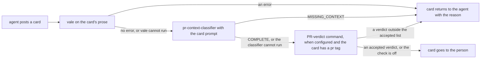

# Example triage agent

This folder is a triage extension you can copy and change. Like `your-attention triage`, it connects to the inbox on the `card.created` hook, so it checks each new card before the person sees it. It then passes the card, or returns it to the agent that posted it, with a reason that agent can act on. Unlike the built-in triage, it runs commands you install yourself. You can read each check in [checks.ts](checks.ts).



## The checks

The checks run in this order, from the cheapest to the slowest, and the first one that returns the card ends the run. A card with a doubled word never costs a model call.

1. **Vale** reads the card's prose, from the title and the text through the recommendation, each option's label and description, and each question with its options. It uses the rules in [vale/Cards](vale/Cards) and nothing else: the [config](vale/.vale.ini) has no `Packages` line, so vale doesn't download a style when it runs. An error returns the card with every error vale found, each with its field, its line in that field, the rule and the words it matched, while warnings only show in the log. The rules:

   | Rule | Level | What it matches |
   | -- | -- | -- |
   | `Cards.FirstPerson` | error | "I", "we", "our" or "my": an agent writes about itself in the third person |
   | `Cards.Placeholders` | error | TODO, TBD, FIXME, XXX, lorem ipsum |
   | `Cards.SessionReferences` | error | "as discussed", "see above" and other words that point into the agent's session |
   | `Cards.Repetition` | error | a doubled word, such as "the the" |
   | `Cards.Hedges` | warning | "maybe", "perhaps", "probably" |

2. **The card classifier** runs `pr-context-classifier -p card-prompt.md -q <question> -` with the card as text on its standard input. With [card-prompt.md](card-prompt.md), the classifier checks that a person could decide from the card alone. The card needs an opening sentence that says what the system does today and what the change would do. It also needs the goal and the options weighed, with evidence and a recommendation. Each term needs an explanation before it appears, and each option says what the agent does if the person picks it. The prompt follows the triage criteria in [SPEC.md](../../SPEC.md#the-triage-extension) and the card guidance agents read. `MISSING_CONTEXT` returns the card with the classifier's rationale and its questions. `COMPLETE` passes it to the next check.

3. **The PR-verdict check** is optional, and only your local config turns it on. It runs on a card that has the tag `pr` set to `owner/repo#number`, such as `pr: acme/api#42`. It runs your command with the pull request's address and `--json` appended, as in `/path/to/your/pr-verdict-command https://github.com/acme/api/pull/42 --json`. The command prints JSON with a `verdict`, a `confidence_accept` between 0 and 1, and `items`, each with a `direction`, an `effect_label`, a `text` and an `action`. A verdict in `acceptVerdicts` passes the card. Any other verdict returns it with the confidence as a number in 100, then the `action` of each item whose direction is `toward_pushback`, or its `text` when `action` is null, each followed by its `effect_label`. `acceptVerdicts` is a list so that a tool with a second passing verdict, such as a lean toward accept, doesn't need a code change. It defaults to `["ACCEPT"]`.

## Failing open

Like the built-in triage, the agent passes a card when a check can't give an answer, and it logs why on standard error. That covers a command that isn't installed, a command that exits with an error, one that runs past its timeout, and output it can't read. The classifier exits with an error when it doesn't find an OpenRouter key, so on a machine without a key the classifier check passes each card. The next check still runs after one that can't, so a missing vale doesn't turn off the classifier.

## Installing the commands

- **Vale**: `brew install vale` on macOS, or a release from [vale.sh](https://vale.sh/docs/install). The example doesn't need `vale sync`.
- **pr-context-classifier**: install it from [elecnix/pr-context-classifier](https://github.com/elecnix/pr-context-classifier) and put `pr-context-classifier` on your `PATH`. The example needs its `-p` flag, which [pull request #12](https://github.com/elecnix/pr-context-classifier/pull/12) adds. An older build rejects `-p` and exits with an error, so the classifier check passes each card.
- **A PR-verdict command**: any program that takes a pull request address and `--json` and prints the JSON above. You don't need one to run the example.

## The OpenRouter key

The classifier finds its own key, and this agent never reads it. The classifier uses `OPENROUTER_API_KEY` when the agent's environment has it. Otherwise it runs the `keyCommand` from `~/.config/pr-context-classifier/config.json` and uses what that command prints:

```json
{"keyCommand": "cat ~/.secrets/openrouter-key"}
```

## The local config

You don't need a config file. With `--config FILE`, the agent reads FILE. Without the flag, it reads the file that `YOUR_ATTENTION_TRIAGE_EXAMPLE_CONFIG` gives, and then `~/.config/your-attention/triage-example.json`. Keep the file on your machine, outside the repository, because the PR-verdict command is your own tool. With none, it runs `vale` and `pr-context-classifier` from your `PATH`, and the PR-verdict check stays off. [triage-example.sample.json](triage-example.sample.json) lists every field:

| Field | Default | Meaning |
| -- | -- | -- |
| `vale` | `["vale"]` | the vale program, then any arguments of yours |
| `classifier` | `["pr-context-classifier"]` | the classifier program, then any arguments of yours, such as `["pr-context-classifier", "-m", "openai/gpt-oss-120b"]` |
| `valeTimeoutMs` | `30000` | how long vale may run |
| `classifierTimeoutMs` | `150000` | how long the classifier may run |
| `prVerdict.command` | none, so the check is off | the PR-verdict program, then its first arguments |
| `prVerdict.acceptVerdicts` | `["ACCEPT"]` | the verdicts that pass the card |
| `prVerdict.timeoutMs` | `300000` | how long the PR-verdict command may run, since it calls GitHub |

Each command is a list, the program and then its arguments, and the agent runs it without a shell. The agent registers with the inbox for a wait of the sum of the timeouts and ten seconds more, at most ten minutes.

## Running it

From a checkout of this repository, with an inbox running on the same machine:

```sh
npm ci
node examples/triage-agent/triage-agent.ts
```

Like `your-attention triage`, it looks for an inbox in two places: `YOUR_ATTENTION_URL` with `YOUR_ATTENTION_TOKEN` set to an extension token, or the inbox this machine serves and its extension token. It connects as `triage-example`, and `--name` sets another name.

It can run beside `your-attention triage`. The inbox shows a card to the person only after every extension on `card.created` passes it, so a card then needs both. To run it instead of the built-in triage, stop `your-attention triage`, or unload the launchd or systemd unit that `your-attention service triage --write` installed, and start this one. `your-attention service` writes units for the built-in commands only, so for a service, point your own unit at `node examples/triage-agent/triage-agent.ts`.

To copy the example out of this repository, keep the folder together, and change the two imports from `../../src/` to your copy of `your-attention`: `loadExtensionConfig` from `src/client.ts` and `runCardHook` from `src/extensions/card-hook.ts`. `runCardHook` reads the extension stream, reconnects after a drop and sends each verdict to the inbox, so the example contains no protocol code.

## Tests

`test/unit/triage-example.test.ts` stands in a small Node script for vale, the classifier and the PR-verdict command. It covers a pass, a vale return, a classifier return, a PR-verdict pass and return, a card without a `pr` tag, the order of the checks, and each way a command can fail. One more test runs the vale rules in this folder with the vale on the machine. Without vale, the test runner skips it.
